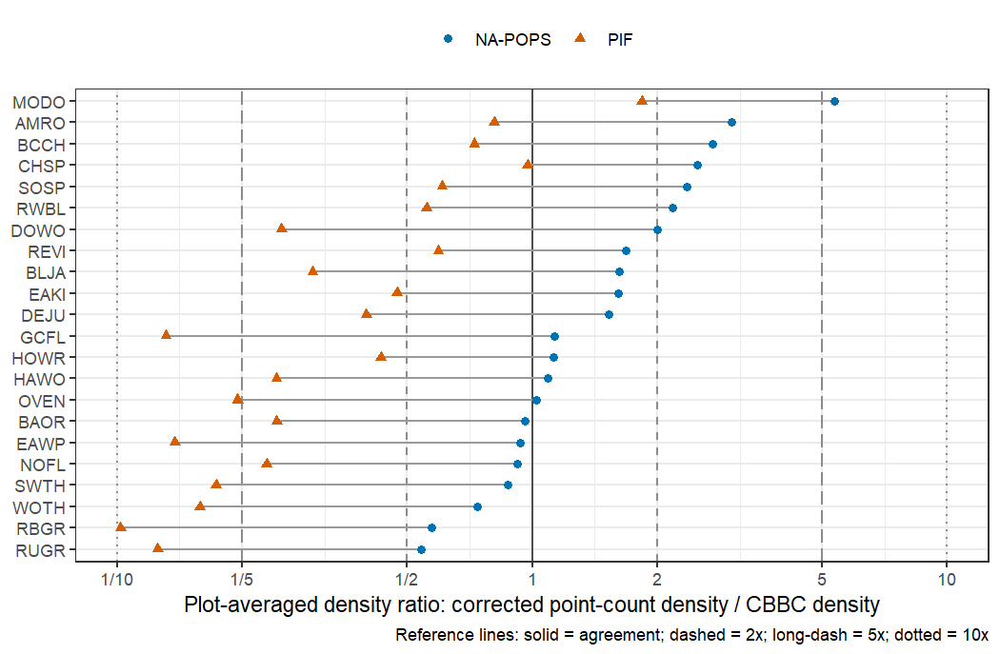
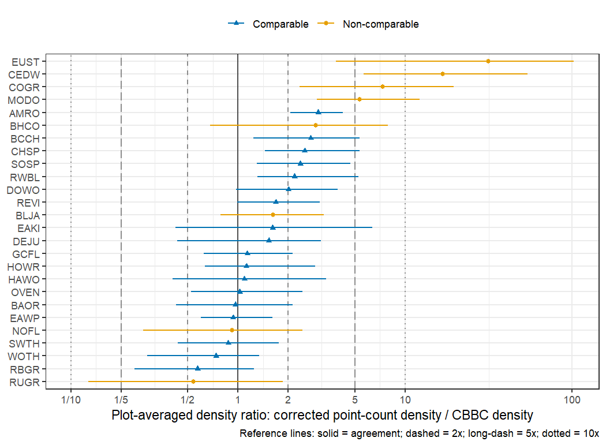
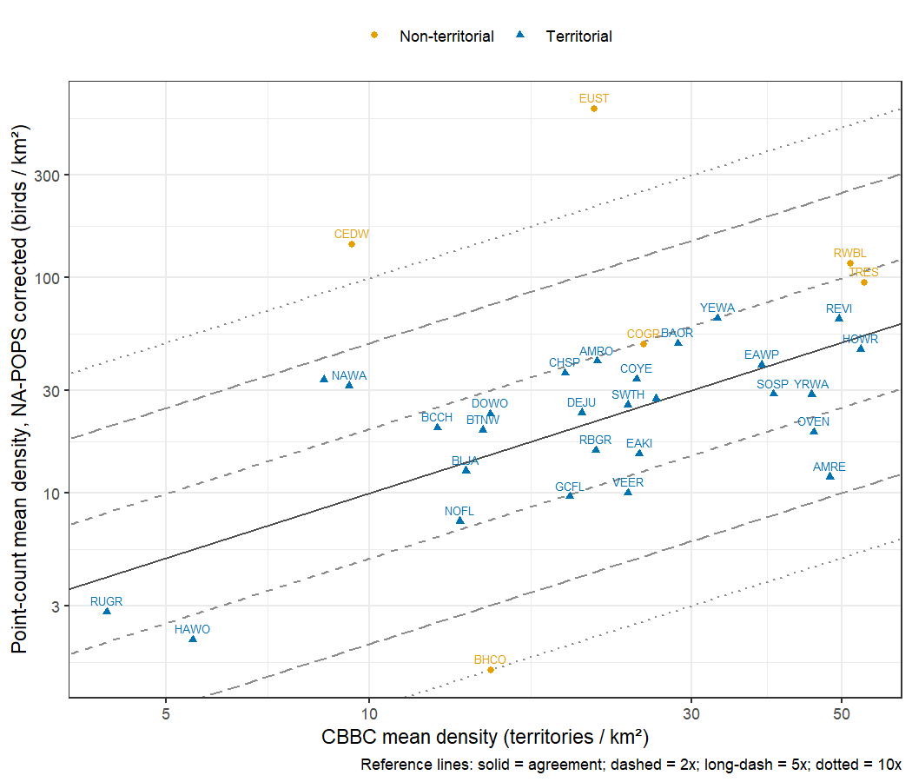
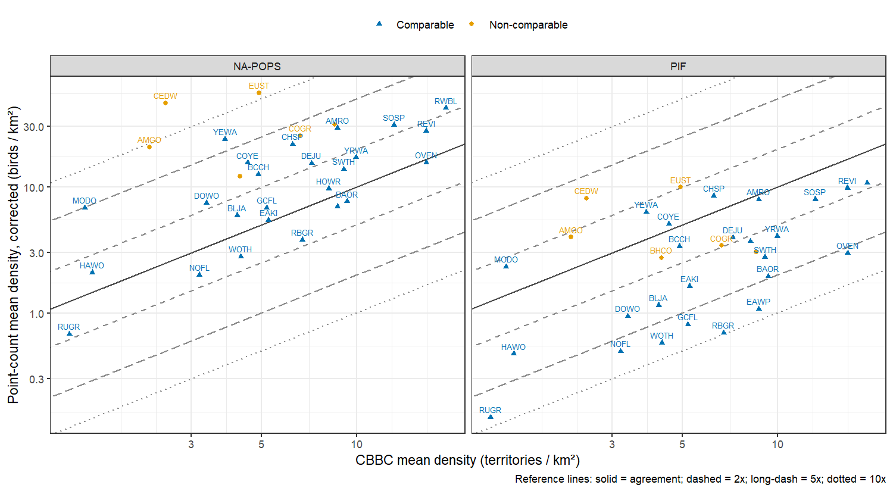
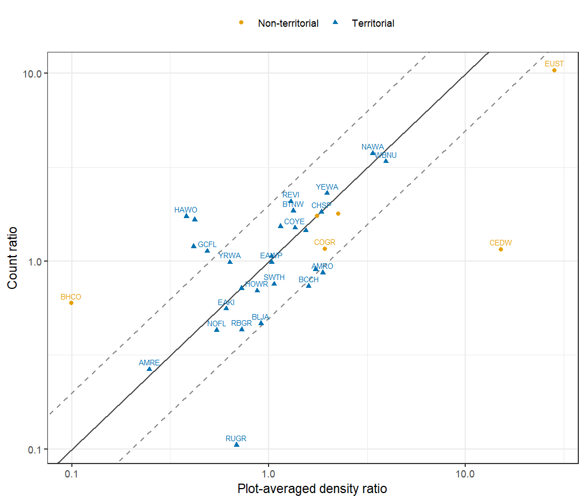
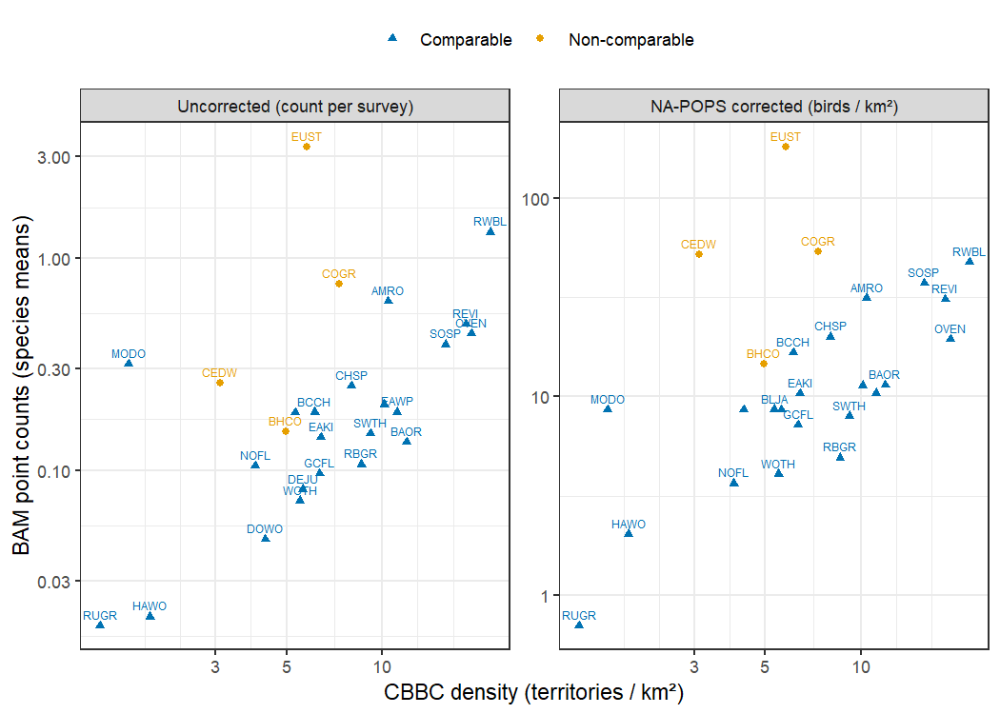
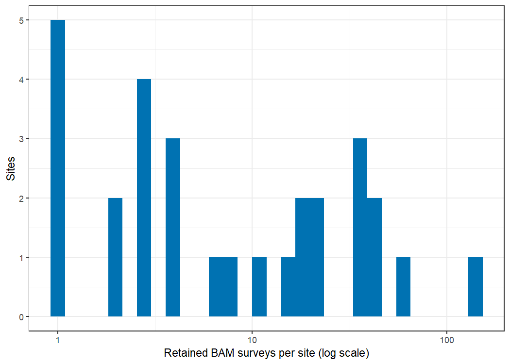
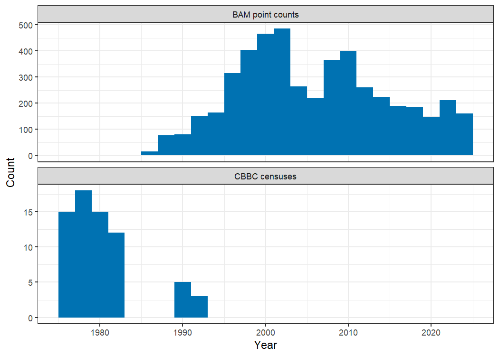

Do NA-POPS-corrected point counts reproduce spot-mapping densities?
Canadian Breeding Bird Census vs BAM
================
David Iles, assisted by Opus 5.5 and GPT-6 Sol
18 November 2026

- [1 Summary](#1-summary)
  - [1.1 Key findings](#11-key-findings)
  - [1.2 How to read these results](#12-how-to-read-these-results)
- [2 Main results](#2-main-results)
  - [2.1 NA-POPS-corrected point counts vs spot mapping](#plot-averaged)
  - [2.2 What the ratios do and do not show](#ratio-caveats)
  - [2.3 PIF corrections instead of NA-POPS](#pif-vs-napops)
- [3 Methods in brief](#methods)
  - [3.1 Data and matching](#methods-data)
  - [3.2 Species compared](#32-species-compared)
  - [3.3 How point counts are compared with CBBC](#methods-ratio)
  - [3.4 PIF corrections](#methods-pif)
- [4 Supporting analyses and robustness checks](#supporting)
  - [4.1 Count ratio: plots weighted by survey
    effort](#observed-expected)
  - [4.2 When the two ratios disagree](#42-when-the-two-ratios-disagree)
  - [4.3 PIF corrections: count-ratio
    check](#43-pif-corrections-count-ratio-check)
  - [4.4 Detection-rate check](#44-detection-rate-check)
  - [4.5 Population change since the
    census](#45-population-change-since-the-census)
  - [4.6 Which plots disagree most?](#plots-disagree)
  - [4.7 Composition: do the datasets agree on which species are
    common?](#composition)
  - [4.8 Composition: does correction improve agreement with
    CBBC?](#48-composition-does-correction-improve-agreement-with-cbbc)
  - [4.9 Composition with PIF
    corrections](#49-composition-with-pif-corrections)
- [5 Data support](#5-data-support)
  - [5.1 Sample sizes](#51-sample-sizes)
  - [5.2 Replication of BAM surveys](#52-replication-of-bam-surveys)
  - [5.3 CBBC plot sizes](#53-cbbc-plot-sizes)
  - [5.4 Timing](#54-timing)
  - [5.5 Geographic representation](#55-geographic-representation)
  - [5.6 Species compared: table](#species-table)
- [6 NA-POPS detectability corrections](#napops-corrections)
- [7 Appendix](#7-appendix)
  - [7.1 How the absolute comparisons work](#absolute-logic)
  - [7.2 Data sources](#72-data-sources)
  - [7.3 Repository structure and
    workflow](#73-repository-structure-and-workflow)
  - [7.4 Reproducing the analysis](#reproducing)
  - [7.5 Settings used](#75-settings-used)
  - [7.6 Code for the calculations](#code)

<!-- CALCULATIONS. Every result is computed in the include = FALSE chunks below, before the first section, so the Summary can quote results whose details come later. The sections then only display tables and figures. The code of these chunks is printed in the appendix (Section 'Code for the calculations'). -->

# 1 Summary

**What this compares.** This repository compares two ways of estimating
breeding-bird density in Canada:

- **Point counts** from the Boreal Avian Modelling (BAM) Project’s
  point-count database, converted to density with detectability
  corrections from **NA-POPS** (Point count Offsets for Population Sizes
  of North American landbirds).
- **Spot mapping** from the **Canadian Breeding Bird Census (CBBC)**, in
  which observers visited fixed plots repeatedly and mapped territories,
  giving densities that need no detectability correction.

If the NA-POPS corrections are about right, corrected point counts near
CBBC plots should give densities of the same magnitude as the CBBC
censuses. It is a plausibility check on the corrections, not a
validation of them; the limitations are set out in Section
<a href="#ratio-caveats">2.2</a>.

**Comparable versus non-comparable species.** The primary analysis
focuses on species for which repeated spot mapping can plausibly
delineate relatively stable breeding territories, and for which
territory density provides a reasonably interpretable reference for
NA-POPS-corrected point-count density. **Non-comparable** species are
those whose breeding ecology may cause systematic differences between
the quantities estimated by the two methods, even with accurate
detectability corrections. Examples include birds that defend only
nesting sites but forage widely, flocking or nomadic species, birds with
ranges much larger than the mapped plots, and species whose territorial
signals occur primarily outside the point-count season. These
differences may introduce bias of uncertain direction, as well as
greater variability in the relationship between point counts and mapped
territories. The classification is based on breeding ecology, not on
whether observed and expected counts agree. Non-comparable species
remain in the data and exploratory all-species results, but are excluded
from the primary comparable-species density and PIF comparisons. A brief
justification for each flagged species is provided in Section
<a href="#noncomparable-justifications">3.2.1</a>.

The same check is repeated with the older **Partners in Flight (PIF)**
corrections that NA-POPS replaced in continental population estimates (a
time-of-day adjustment instead of availability, and an expert-assigned
detection distance instead of EDR), to see which set of corrections
brings point counts closer to the CBBC censuses (Section
<a href="#pif-vs-napops">2.3</a>).

## 1.1 Key findings

All results below use **36 final CBBC locations**, after excluding CBBC
plots with inadequate effort, those with no nearby point counts, and
several distinct plots with identical coordinates that could not be
uniquely assigned to paired point counts. To be included in this
analysis, species must have been observed in **at least 10 of these
remaining CBBC locations**. All numerical results below are computed for
this restricted sample.

- **NA-POPS-corrected point counts vs spot mapping.** For the 18
  comparable species, NA-POPS-corrected point-count density is a median
  of **1.33 times** the CBBC territory density (plot-averaged density
  ratio). Individual species are typically 1.57-fold from agreement in
  either direction; 67% are within 2× and 100% within 10× (Section
  <a href="#plot-averaged">2.1</a>).
- **PIF vs NA-POPS.** The older PIF corrections assume each survey
  samples a median of 3.9 times as many birds as NA-POPS does, so they
  give lower densities. With PIF the median density ratio is **0.32**,
  against **1.33** with NA-POPS, so on the median NA-POPS is closer to
  agreement. PIF is closer for 5 of 18 comparable species (Section
  <a href="#pif-vs-napops">2.3</a>).
- **Composition.** Before any correction, CBBC and BAM relative
  abundances have a Spearman correlation of 0.58 across species.
  Uncorrected and NA-POPS-corrected abundance have a Spearman
  correlation of 0.87 across species, which measures how much the
  corrections re-rank species (Section <a href="#composition">4.7</a>).

Figure 1.1: Plot-averaged density
ratio (NA-POPS- or PIF-corrected point-count density / CBBC territory
density) by comparable species, sorted by the NA-POPS ratio. Each line
joins one species’ two ratios. A ratio of 1 means agreement.

| Role | Comparison | Metric | Value |
|:---|:---|:---|:---|
| Main | Plot-averaged density ratio, NA-POPS (comparable species) | Median ratio | 1.33 |
| Main | Plot-averaged density ratio, NA-POPS (comparable species) | Median fold difference (either direction) | 1.57 |
| Main | Plot-averaged density ratio, NA-POPS (comparable species) | Share within 2x / 10x | 67% / 100% |
| Main | Plot-averaged density ratio, PIF (comparable species with PIF values) | Median ratio | 0.32 |
| Main | Plot-averaged density ratio, PIF (comparable species with PIF values) | Median fold difference (either direction) | 3.18 |
| Main | Plot-averaged density ratio, PIF (comparable species with PIF values) | Share within 2x / 10x | 33% / 100% |
| Main | PIF vs NA-POPS, plot-averaged density ratio (comparable species) | Share of species closer to 1 with PIF | 28% |
| Check | Count ratio, NA-POPS (comparable species) | Median ratio | 1.58 |
| Check | Count ratio, NA-POPS (comparable species) | Share within 2x | 61% |
| Check | Detection rate (comparable species) | Observed / expected, median | 1.53 |
| Composition | CBBC vs BAM uncorrected (all species, all matched sites) | Spearman, species shares | 0.58 |
| Composition | CBBC vs BAM NA-POPS-corrected (all species) | Spearman, species means | 0.50 |

Table 1.1: Key results (every comparison
uses all matched CBBC grids)

## 1.2 How to read these results

This is a plausibility check on the NA-POPS corrections, not a
validation of them. A ratio near 1 means corrected point counts give
densities of the same magnitude as an independent, intensive census.
Even with perfect corrections the ratio need not be 1:

- **Birds vs territories.** Point counts may include non-territorial
  individuals, while spot mapping records territories, so ratios
  somewhat above 1 are expected.
- **Time.** The censuses and the point counts are a median of 28 years
  apart (Section <a href="#timing">5.4</a>), and populations have
  changed in between.
- **Habitat.** Points within 2 km of a plot can sample habitat the plot
  does not represent. Point counts in this analysis therefore represent
  a broader collection of habitats than CBBC plots that were selected
  within relatively uniform habitats.

The 95% intervals are sampling intervals: they take the NA-POPS
corrections and CBBC densities as given, and do not include uncertainty
in the corrections, which is dominated by EDR (Section
<a href="#napops-corrections">6</a>). Section
<a href="#ratio-caveats">2.2</a> sets out what moves the ratios.

**How this report is organized.** Section <a href="#main-results">2</a>
gives the main results and Section <a href="#methods">3</a> the methods
in brief. The checks on those results (Section
<a href="#supporting">4</a>), the data behind them (Section
<a href="#data-support">5</a>) and the NA-POPS corrections themselves
(Section <a href="#napops-corrections">6</a>) follow. The appendix
(Section <a href="#appendix">7</a>) has a worked example of the
calculations, the data sources, how to reproduce the analysis and all
the code.

# 2 Main results

## 2.1 NA-POPS-corrected point counts vs spot mapping

**What this shows.** For each species, the mean NA-POPS-corrected
point-count density across all its matched CBBC grids, divided by the
mean CBBC territory density over the same grids (the plot-averaged
density ratio; Section <a href="#methods-ratio">3.3</a>). Each plot
contributes equally, however many surveys it has. Grids where spot
mapping found no territories of a species add their corrected density to
the numerator only, and the per-species table shows how much of each
species’ corrected density comes from them. Intervals come from the site
bootstrap. A species with no birds counted gets a ratio of 0 with a
degenerate interval here, so use its count-ratio interval instead
(Section <a href="#observed-expected">4.1</a>).

| Species | Number of species | Median density ratio | Median fold difference (either direction) | Share within 2x | Share within 5x | Share within 10x | Median Spearman across plots |
|:---|----|---:|---:|---:|---:|---:|---:|
| Comparable | 18 | 1.33 | 1.57 | 0.67 | 1.00 | 1.00 | 0.45 |
| All species | 26 | 1.61 | 1.71 | 0.58 | 0.85 | 0.92 | 0.44 |

Table 2.1: Plot-averaged
density ratio (corrected point-count density / CBBC density): median
across species, median fold difference from agreement in either
direction, share of species within 2x, 5x and 10x, and median
within-species Spearman correlation across plots

| species | Grids | Grids with CBBC territories | Mean CBBC density (/ km²) | Mean corrected density (/ km²) | Density ratio (95% sampling interval) | Corrected density from grids without CBBC territories |
|:---|---:|---:|----|---:|:---|:---|
| RBGR | 36 | 14 | 8.6 | 4.9 | 0.57 (0.24-1.25) | 43% |
| WOTH | 36 | 10 | 5.5 | 4.1 | 0.74 (0.29-1.34) | 13% |
| SWTH | 36 | 13 | 9.2 | 8.0 | 0.87 (0.44-1.76) | 14% |
| EAWP | 36 | 14 | 11.1 | 10.4 | 0.93 (0.60-1.61) | 20% |
| BAOR | 36 | 14 | 11.9 | 11.5 | 0.96 (0.42-2.12) | 14% |
| OVEN | 36 | 14 | 19.0 | 19.5 | 1.02 (0.53-2.43) | 45% |
| HAWO | 36 | 13 | 1.9 | 2.0 | 1.09 (0.41-3.37) | 61% |
| HOWR | 36 | 11 | 10.1 | 11.4 | 1.12 (0.63-2.89) | 21% |
| GCFL | 36 | 13 | 6.3 | 7.2 | 1.13 (0.62-2.12) | 37% |
| DEJU | 36 | 10 | 5.6 | 8.6 | 1.53 (0.43-3.15) | 16% |
| EAKI | 36 | 10 | 6.4 | 10.4 | 1.61 (0.42-6.35) | 72% |
| REVI | 36 | 17 | 18.3 | 30.8 | 1.68 (0.99-3.08) | 43% |
| DOWO | 36 | 14 | 4.3 | 8.6 | 2.00 (0.98-3.96) | 38% |
| RWBL | 36 | 17 | 21.8 | 47.5 | 2.18 (1.31-5.26) | 4% |
| SOSP | 36 | 17 | 15.8 | 37.2 | 2.36 (1.30-4.70) | 24% |
| CHSP | 36 | 16 | 8.0 | 20.0 | 2.50 (1.45-5.33) | 49% |
| BCCH | 36 | 18 | 6.1 | 16.7 | 2.72 (1.23-5.35) | 23% |
| AMRO | 36 | 16 | 10.4 | 31.4 | 3.02 (2.06-4.24) | 23% |

Table 2.2: Plot-averaged
density ratio by comparable species, with its 95% site-bootstrap
sampling interval, and the share of the species’ summed corrected
density that comes from grids where spot mapping found no territories of
it

Figure 2.1: Plot-averaged
density ratio (corrected point-count density / CBBC density) by species,
with 95% site-bootstrap sampling intervals.

Figure 2.2: Species mean
densities across all matched grids: NA-POPS-corrected point counts vs
CBBC.

For comparable species, the median plot-averaged density ratio is
**1.33**, with a median fold difference of 1.57 in either direction, 67%
of species within 2× of agreement and 100% within 10×.

**How to read:**

- **Systematic bias vs scatter.** The median ratio shows whether
  corrected point counts run systematically above or below CBBC
  densities; the median fold difference shows how far individual species
  typically are from agreement in either direction. A median near 1 with
  large scatter means no overall bias but poor species-level agreement.
- **Grids without CBBC territories.** A large share of a species’
  corrected density from these grids means it was often counted near
  plots where spot mapping found none: either the points sample habitat
  the plot does not represent (most likely for edge and
  early-successional species), or the species colonized those plots
  after the census. Either way, its ratio is raised by something other
  than detectability.
- **Agreement across plots.** The median Spearman correlation across
  plots shows whether, within a species, corrected densities are higher
  where CBBC densities are higher. Each site’s point-count density rests
  on few surveys (Table <a href="#tab:step1b-1">5.5</a>), so low
  correlations are expected even if the corrections are right.

## 2.2 What the ratios do and do not show

A ratio of 1 means NA-POPS-corrected counts reproduce CBBC territory
densities on average for that species. It does not, on its own, show
that availability and EDR are right, because other things move the
ratios:

- non-territorial birds contribute to point counts but not to
  spot-mapped territories
- spot mapping also misses some territories; point counts in this
  analysis often sample habitat the CBBC plot does not represent
- populations have changed in the several decades that elapsed between
  the CBBC and point count surveys

The detection-rate check (Section <a href="#supporting">4</a>)
complements both ratios, because it compares how often surveys detect
the species at all, which pairs and family groups do not inflate.

## 2.3 PIF corrections instead of NA-POPS

**Question.** Before NA-POPS, Partners in Flight (PIF) continental
population estimates (Blancher et al. 2013; Stanton et al. 2019)
converted Breeding Bird Survey counts to densities with two
species-level corrections: a **time-of-day adjustment**, since replaced
by NA-POPS availability, and a **maximum detection distance (MDD)**,
since replaced by the NA-POPS EDR. Do the PIF corrections bring point
counts closer to, or further from, what CBBC densities predict?

**How it is calculated.** Exactly as for NA-POPS: the same surveys,
grids and CBBC densities; only each survey’s effective area changes
(Section <a href="#methods-pif">3.4</a>). Two hybrid corrections swap
one component at a time, to show which replacement matters.

| Corrections | Median | 10% | 90% | Species with more birds expected than with NA-POPS |
|:---|---:|---:|---:|:---|
| PIF | 3.90 | 2.70 | 6.37 | 100% |
| PIF time of day + NA-POPS EDR | 1.11 | 0.89 | 1.78 | 72% |
| NA-POPS availability + PIF MDD | 3.71 | 2.28 | 5.61 | 100% |

Table 2.3: Comparable species: birds
expected with the PIF and hybrid corrections, relative to birds expected
with NA-POPS (ratio of totals over each species’ surveys). Above 1: the
corrections assume the surveys sample more birds, so they give lower
densities

| Species | Corrections | Number of species | Median density ratio | Median fold difference (either direction) | Share within 2x | Share within 5x | Share within 10x | Median Spearman across plots |
|:---|:---|----|---:|---:|---:|---:|---:|---:|
| Comparable | NA-POPS | 18 | 1.33 | 1.57 | 0.67 | 1.00 | 1.00 | 0.45 |
| Comparable | PIF | 18 | 0.32 | 3.18 | 0.33 | 0.67 | 1.00 | 0.44 |
| Comparable | PIF time of day + NA-POPS EDR | 18 | 0.99 | 1.48 | 0.78 | 1.00 | 1.00 | 0.44 |
| Comparable | NA-POPS availability + PIF MDD | 18 | 0.45 | 2.22 | 0.39 | 0.72 | 1.00 | 0.45 |
| All species | NA-POPS | 26 | 1.61 | 1.71 | 0.58 | 0.85 | 0.92 | 0.44 |
| All species | PIF | 26 | 0.42 | 3.14 | 0.35 | 0.69 | 1.00 | 0.43 |
| All species | PIF time of day + NA-POPS EDR | 26 | 1.07 | 1.70 | 0.65 | 0.92 | 0.96 | 0.43 |
| All species | NA-POPS availability + PIF MDD | 26 | 0.48 | 2.25 | 0.35 | 0.69 | 1.00 | 0.44 |

Table 2.4: Plot-averaged density ratio
(corrected point-count density / CBBC density) with NA-POPS, PIF and
hybrid corrections, for the species with PIF values (same surveys and
grids for every set)

| species | Mean CBBC density (/ km²) | Density ratio, NA-POPS | Density ratio, PIF (95% sampling interval) | Closer to 1 | PIF time of day | PIF MDD (m) | NA-POPS EDR (m) | PIF pair adjustment |
|:---|---:|---:|:---|:---|---:|---:|---:|---:|
| RBGR | 8.6 | 0.57 | 0.10 (0.05-0.23) | NA-POPS | 0.86 | 200 | 97 | 2.00 |
| WOTH | 5.5 | 0.74 | 0.16 (0.06-0.28) | NA-POPS | 0.43 | 200 | 84 | 2.00 |
| SWTH | 9.2 | 0.87 | 0.17 (0.08-0.36) | NA-POPS | 0.60 | 200 | 85 | 2.00 |
| EAWP | 11.1 | 0.93 | 0.14 (0.09-0.23) | NA-POPS | 0.90 | 200 | 86 | 2.00 |
| BAOR | 11.9 | 0.96 | 0.24 (0.12-0.57) | NA-POPS | 0.87 | 125 | 86 | 1.75 |
| OVEN | 19.0 | 1.02 | 0.19 (0.09-0.56) | NA-POPS | 0.81 | 200 | 91 | 2.00 |
| HAWO | 1.9 | 1.09 | 0.24 (0.08-0.68) | NA-POPS | 0.78 | 125 | 73 | 2.00 |
| HOWR | 10.1 | 1.12 | 0.43 (0.25-1.09) | NA-POPS | 0.85 | 125 | 81 | 2.00 |
| GCFL | 6.3 | 1.13 | 0.13 (0.07-0.23) | NA-POPS | 0.80 | 200 | 83 | 1.75 |
| DEJU | 5.6 | 1.53 | 0.40 (0.13-0.85) | NA-POPS | 0.58 | 125 | 63 | 2.00 |
| EAKI | 6.4 | 1.61 | 0.47 (0.13-1.63) | NA-POPS | 0.87 | 125 | 88 | 1.75 |
| REVI | 18.3 | 1.68 | 0.59 (0.34-1.09) | NA-POPS | 0.78 | 125 | 77 | 2.00 |
| DOWO | 4.3 | 2.00 | 0.25 (0.11-0.51) | NA-POPS | 0.74 | 125 | 59 | 2.00 |
| RWBL | 21.8 | 2.18 | 0.56 (0.35-1.29) | PIF | 0.74 | 200 | 107 | 1.25 |
| SOSP | 15.8 | 2.36 | 0.61 (0.34-1.20) | PIF | 0.69 | 125 | 68 | 2.00 |
| CHSP | 8.0 | 2.50 | 0.97 (0.58-1.98) | PIF | 0.50 | 125 | 73 | 2.00 |
| BCCH | 6.1 | 2.72 | 0.73 (0.34-1.37) | PIF | 0.68 | 125 | 75 | 2.00 |
| AMRO | 10.4 | 3.02 | 0.81 (0.55-1.15) | PIF | 0.44 | 200 | 95 | 2.00 |

Table 2.5: Comparable species:
plot-averaged density ratios with NA-POPS and PIF corrections, which is
closer to agreement (1), and the corrections themselves (PIF time of day
is for a 3-min BBS stop)

The species-by-species comparison of NA-POPS and PIF ratios is Figure
<a href="#fig:summary-figure">1.1</a>.

Figure 2.3: Species mean densities
across all matched grids: NA-POPS-corrected (left) and PIF-corrected
(right) point counts vs CBBC, species with PIF values. CBBC densities
are the same in both panels; only the corrected densities change.

26 of the 26 species compared have PIF values. For comparable species,
PIF corrections expect a median of **3.9 times** as many birds as
NA-POPS (Table <a href="#tab:step3-pif-1">2.3</a>), so they give
correspondingly lower corrected densities. The median plot-averaged
density ratio is **0.32** with PIF corrections and **1.33** with
NA-POPS, with median fold differences from agreement of 3.18 and 1.57,
and 33% and 67% of species within 2× of agreement, respectively (Table
<a href="#tab:step3-pif-2">2.4</a>). PIF brings **5 of 18** comparable
species closer to agreement (28%; exact 95% interval 10%-53%). With
plots weighted by survey effort instead, the median count ratio is 0.4
with PIF and 1.58 with NA-POPS (Table
<a href="#tab:step3-pif-3">4.4</a>).

**How to read:**

- **Which way PIF moves the ratios.** In Table
  <a href="#tab:step3-pif-1">2.3</a>, values above 1 mean PIF assumes
  the surveys sample more birds than NA-POPS does, which lowers
  corrected densities and the density ratio (and, in a population
  estimate, the population). In Figure
  <a href="#fig:step3-pif-means">2.3</a>, this moves every species down
  from its NA-POPS position by about that factor: a factor shared by all
  species shifts the cloud of points off the 1:1 line without changing
  its scatter. The two hybrid rows split the difference into its two
  parts: time of day instead of availability, and MDD instead of EDR.
  Effective area grows with the square of the detection radius, so MDD
  vs EDR usually dominates for unlimited-distance counts, where it
  changes the area by (MDD / EDR)². For counts truncated at 50 or 100 m,
  both areas approach the truncation circle (π *r*²) when the radius is
  well beyond the limit, so the distance part shrinks.
- **Closer to 1 is not automatically better.** As Section
  <a href="#ratio-caveats">2.2</a> explains, the density ratio would sit
  below 1 even with perfect corrections if populations had declined
  since the census, and above 1 where pairs, fledglings and
  non-territorial birds are counted, or where points near a plot sample
  habitat the plot does not represent. A correction that moves ratios
  toward 1 is better only if those effects are small. In particular, if
  NA-POPS ratios already run above 1, PIF corrections can look better
  partly by offsetting the counting of individuals against territories,
  rather than by being better detectability corrections.
- **Hybrids.** If a hybrid agrees better than both full sets (Table
  <a href="#tab:step3-pif-2">2.4</a>), one component of each set is
  closer to the census than the other: for example, NA-POPS availability
  with PIF MDD agreeing best would point to EDR, not availability, as
  the source of any NA-POPS inflation.
- **Uncertainty.** As elsewhere, the intervals are sampling intervals
  that take the corrections as given. The PIF corrections carry no
  uncertainty here, and the time-of-day value refers to BBS timing
  rather than each BAM survey’s own date and time.

# 3 Methods in brief

## 3.1 Data and matching

**Point counts.** Human point counts from the BAM database (no ARU
recordings, no eBird checklists), within 2 km of retained CBBC plots, in
the breeding season and in the morning (filters in
`P2_match_bam_surveys.R`; Table <a href="#tab:step1a-2">5.2</a>). All
plots in coordinate groups containing multiple distinct CBBC SITEIDs
were excluded before assignment, because their identical recorded
positions cannot identify which historical plot nearby surveys
represent. Among the initially survey-matched plots, this excluded **27
plots in 6 coordinate groups**; **36 uniquely located CBBC sites**
remain. Each retained BAM survey is assigned once to its nearest
eligible plot *in P2*, before species selection.

**Why spot mapping.** CBBC observers visited each plot repeatedly (at
least the minimum number of visits set in P1; Table
<a href="#tab:step1a-1">5.1</a>) and mapped territories, so CBBC
densities are territories per unit area, including fractions of
territories crossing the plot edge, with no detectability correction
involved. For territorial songbirds detected mainly by song, this is
approximately the quantity a corrected point count estimates. The two
are not identical: point counts record individuals (which may include
non-territorial individuals), whereas spot mapping records territories.
Spot mapping also misses some territories, so CBBC is treated as an
independent reference rather than the truth.

**Sites compared.** Every comparison uses the final matched,
coordinate-unambiguous CBBC sites for every species, including sites
where spot mapping found no territories of that species (CBBC density
0). The species occurrence threshold is also evaluated on exactly these
final sites. Two things argue for including sites with CBBC zeros:

- **No selection on the outcome.** Keeping only grids where spot mapping
  found a species selects grids where its CBBC density was high partly
  by chance, and biases CBBC densities upward relative to the point
  counts.
- **Turnover since the census.** Over the decades between the censuses
  and the point counts, species were lost from some plots and gained at
  others. Keeping only grids where the species held territories at the
  census keeps the losses but discards the gains, which biases
  point-count densities downward. Including all retained sites allows
  both apparent losses and gains to contribute, although spatially
  heterogeneous change, imperfect census coverage and habitat
  differences remain.

The cost is habitat mismatch: points within 2 km of a plot can sample
habitat the plot does not represent (for example, edges or young forest
around a mature-forest plot), so a species can be counted near a plot
where spot mapping found none.

## 3.2 Species compared

**Scope.** Species are selected if CBBC territories were recorded at
**10 or more of the 36 final, uniquely located sites** (set in P3), and
an NA-POPS model is available, without which counts cannot be corrected.
Nothing about BAM detections, availability or EDR is used to determine
eligibility, so no species is included or excluded because of how well
BAM and CBBC agree. All eligible species are retained, but **only
comparable species contribute to the primary density-agreement
summaries**. The biologically motivated, judgment-based classification
is defined centrally in P1 (`NON_COMPARABLE_SPECIES`; Section
<a href="#settings-used">7.5</a>) and distinguishes species with readily
interpreted breeding territories from those whose point-count detections
cannot reliably be assigned to a comparable local territory. This is a
statement about the compatibility of the two measurements, not about the
quality of either survey method.

26 of 26 candidate species have NA-POPS models and are compared (18
comparable, 8 non-comparable). 0 of them were never detected by a
matched BAM survey. The species are listed in Table
<a href="#tab:step1-species-2">5.8</a>.

### 3.2.1 Why particular species are classified as non-comparable

The following table covers **every code flagged as non-comparable in
P1**, including species that do not meet the occurrence threshold in the
current run. The reason is specifically why birds recorded on short
point counts may not correspond closely to the density of breeding
territories inferred from repeated spot mapping. Some of these birds do
defend nests or territories; the flag does **not** mean they are wholly
nonterritorial. The classification is a conservative ecological judgment
made independently of the observed/expected ratios.

| Species | Common name | In this run | Why point counts and mapped territories may differ |
|:---|:---|:---|:---|
| BLJA | Blue Jay | Yes | Broad, overlapping home ranges and inconspicuous territorial boundaries make spot-mapped units hard to match to point-count birds. |
| BHCO | Brown-headed Cowbird | Yes | Brood parasite: females do not hold a conventional nesting territory, and birds visit multiple host territories. |
| CEDW | Cedar Waxwing | Yes | Social flocks, mobile feeding and relatively weak nesting-area defence make detections poor indicators of local territories. |
| COGR | Common Grackle | Yes | Often nests in loose groups and mainly defends the nest vicinity; birds forage well beyond it. |
| EUST | European Starling | Yes | Primarily defends nest cavities and feeds in mobile groups; observed birds need not belong to nests on the plot. |
| MODO | Mourning Dove | Yes | Defends a localized nesting area but may travel far to feed; point-count birds need not occupy a local nesting territory. |
| NOFL | Northern Flicker | Yes | Nest-site defence and extensive ground-foraging movements can place counted birds far from their nesting areas. |
| RUGR | Ruffed Grouse | Yes | Males have drumming territories, but peak drumming is usually earlier than the May–July point-count window; females and non-drumming birds are sampled differently. |
| AMCR | American Crow | No | Family groups and broad, mobile foraging ranges can extend well beyond a small mapped breeding plot. |
| AMGO | American Goldfinch | No | Loose territoriality, flocking and late/variable nesting make birds counted locally hard to pair with fixed mapped territories. |
| BANS | Bank Swallow | No | Colonial burrow nesting and extensive aerial foraging decouple local flight counts from nesting territories. |
| BARS | Barn Swallow | No | Defends nest sites but forages widely on the wing; birds passing a point may nest elsewhere. |
| CHSW | Chimney Swift | No | Nest-site-focused defence and wide-ranging aerial feeding mean birds overhead may not breed locally. |
| CLSW | Cliff Swallow | No | Dense nesting colonies and wide aerial feeding movements make counts of flying birds unlike mapped territory counts. |
| CORA | Common Raven | No | Very large territories and far-ranging movements exceed the scale of most CBBC plots. |
| EVGR | Evening Grosbeak | No | Flocking, nomadic movements and weakly exclusive breeding areas complicate assignment to local territories. |
| HOSP | House Sparrow | No | Groups nest around buildings, defending mainly nest sites while sharing feeding areas. |
| NRWS | Northern Rough-winged Swallow | No | Defends nesting burrows but feeds widely in flight; aerial detections are poorly tied to local nests. |
| PISI | Pine Siskin | No | Irruptive, often flocking and mobile, with variable breeding locations and weakly exclusive feeding areas. |
| PUMA | Purple Martin | No | Often nests in colonies or clustered cavities and forages widely in the air, so local flight counts differ from nesting sites. |
| RECR | Red Crossbill | No | Nomadic, flocking and opportunistic breeding tied to seed crops makes fixed territory density a poor comparison. |
| ROPI | Rock Pigeon | No | Colonial or clustered nesting and wide-ranging flock foraging make point-count birds poorly attributable to local nests. |
| TRES | Tree Swallow | No | Defends a nest cavity while feeding broadly in flight; detections at a point need not represent local breeding pairs. |
| WWCR | White-winged Crossbill | No | Nomadic flocks and opportunistic conifer-seed-driven breeding make a fixed, exclusive territory hard to enumerate. |

Table 3.1: Ecological
justifications for every species flagged non-comparable in P1 (including
species not eligible in this run)

## 3.3 How point counts are compared with CBBC

**Effective area.** NA-POPS converts a point count to a density by
dividing it by the area the survey effectively sampled. For survey *j*:

> *A**j* = *p**j* × π × EDR² × (1 −
> exp(−(*r**j* / EDR)²)) / 106 (km²)

where *p**j* is availability, the probability that a bird
present sings or calls during the count (NA-POPS removal model; it
depends on the survey’s duration, day of year and time since sunrise),
EDR is the species’ effective detection radius (m; NA-POPS
intercept-only distance model), and *r**j* is the survey’s
distance limit (m). For an unlimited-distance count the last factor is
1.

**Plot-averaged density ratio (main comparison).** For each species and
CBBC grid *g*, the corrected point-count density is *B**g* =
Σ count / Σ *A**j* over the surveys assigned to the grid. The
CBBC density *D**g* is territories on the plot divided by
plot area, averaged over the grid’s census years. The species’ ratio is
*R* = mean(*B**g*) / mean(*D**g*) over all its
matched grids, so *R* = 1 means corrected point counts reproduce CBBC
territory densities on average. Every plot gets equal weight, whatever
its number of surveys. That matters here because survey effort ranges
from one survey to well over 100 per site (Table
<a href="#tab:step1b-1">5.5</a>).

**Count ratio (check).** Birds counted divided by birds expected, Σ
count / Σ (*A**j* × *D**g*), over the species’
surveys. It is the maximum-likelihood estimate under a Poisson model,
but weights each plot by its survey effort, so one heavily surveyed plot
can dominate it.

**Intervals.** The 95% sampling intervals come from a site bootstrap:
sites are resampled with all their surveys, so repeat visits and nearby
points move together. They describe how much the results depend on which
sites and surveys happened to be available, taking the NA-POPS
corrections and the CBBC densities as given. They do not include
uncertainty in the corrections themselves (model choice, NA-POPS
release, availability), error in the historical CBBC densities,
population change or spatial mismatch. Because density scales with 1 /
EDR² for unlimited-distance counts, errors in EDR dominate that
uncertainty (Section <a href="#napops-corrections">6</a>).

The appendix (Section <a href="#absolute-logic">7.1</a>) works through
both ratios with a small invented example, and explains how plot size
and survey effort enter them.

## 3.4 PIF corrections

PIF converts counts to densities with a time-of-day adjustment instead
of availability, and a maximum detection distance (MDD) instead of EDR.
The PIF effective area (computed in `P4_pif_corrections.R`) is:

> *A**j*PIF = *p**j*PIF × π
> × MDD² × (1 − exp(−(*r**j* / MDD)²)) / 106

- **MDD** (m) is the PIF detection distance, treated here as an
  expert-elicited estimate of the species’ EDR, so the formula is the
  NA-POPS one with MDD in place of EDR. Despite the name “maximum
  detection distance”, PIF uses it as the radius of the area a count
  samples (π × MDD²), the role EDR plays in NA-POPS. The PIF handbook
  (version 3.1) acknowledges that not all birds within that distance are
  detected, notes that its distance classes tend to run larger than
  empirical effective detection distances, and names replacing them with
  EDRs as the next step. With the same half-normal detection function
  for both, PIF and NA-POPS differ only in the value of the radius. For
  unlimited-distance counts the area is *p**j*PIF
  × π × MDD².
- ***p**j*PIF** comes from the PIF time-of-day
  value *T*: the share of birds counted at the mean BBS time of day
  relative to the species’ peak time, on a 3-min BBS stop. BAM surveys
  last 3 to 10 min, so *T* is rescaled to each survey’s duration *d*
  (min) assuming a constant cue rate, *p*PIF = 1 − (1 −
  *T*)*d*/3, the same rescaling used for the 5-min
  availability in Table <a href="#tab:step1-species-2">5.8</a> (setting
  `pif_scale_duration` in P4: **TRUE**; if FALSE, *T* is used unchanged
  for every survey). Unlike NA-POPS availability, it does not change
  with date or time since sunrise.
- **The PIF pair adjustment is not used.** PIF multiplies densities by a
  pair adjustment (1 to 2) to convert birds counted to individuals.
  NA-POPS did not replace it, and both comparisons here set birds
  counted against territories, so leaving it out means any difference
  between the NA-POPS and PIF ratios comes only from the two corrections
  that NA-POPS replaced. Species with a pair adjustment below 2 are, by
  PIF’s own reckoning, counted as more than one bird per territory (both
  sexes, or family groups), so their ratios should run above 1 under
  either set of corrections.
- **Hybrids.** To show which replacement matters, two hybrid corrections
  swap one component at a time: PIF time of day with the NA-POPS EDR,
  and NA-POPS availability with the PIF MDD.

Corrections that assume a survey samples more birds give lower corrected
densities, a lower density ratio, and smaller populations. For one
species, the PIF count ratio divided by the NA-POPS count ratio equals
birds expected with NA-POPS divided by birds expected with PIF. The
plot-averaged density ratio moves by about the same factor, though not
exactly, because the PIF / NA-POPS effective-area ratio varies somewhat
between surveys of one species (with duration and distance limit).

# 4 Supporting analyses and robustness checks

These analyses check whether the main results depend on how plots are
weighted, on how many birds are recorded per detection, on the time
since the census and on plot characteristics, and compare species
composition.

## 4.1 Count ratio: plots weighted by survey effort

**What this shows.** For each species, the total number of birds counted
by its surveys divided by the total expected from CBBC density and each
survey’s NA-POPS effective area (the observed and expected counts of
Table <a href="#tab:step1-species-2">5.8</a>). It weights each grid by
its survey effort multiplied by its CBBC density, so it checks whether
the plot-averaged result holds when every survey counts equally, and
shows where a few heavily surveyed grids dominate.

| Species | Number of species | Median count ratio | Median fold difference (either direction) | Share within 2x | Share within 5x | Species with no birds counted |
|:---|----|---:|---:|---:|---:|---:|
| Comparable | 18 | 1.58 | 1.60 | 0.61 | 0.94 | 0 |
| All species | 26 | 1.60 | 1.81 | 0.50 | 0.88 | 0 |

Table 4.1: Count ratio (birds
counted / birds expected): median across species, median fold difference
from agreement in either direction, and share of species within 2x and
5x of agreement

| species | Grids | Grids with CBBC territories | Surveys | Birds counted | Birds expected | Count ratio (95% sampling interval) | Largest site’s share of expected |
|:---|---:|---:|---:|---:|---:|:---|:---|
| RBGR | 36 | 14 | 1250 | 247 | 499.8 | 0.49 (0.28-4.49) | 81% |
| WOTH | 36 | 10 | 1250 | 164 | 194.6 | 0.84 (0.57-5.23) | 92% |
| EAKI | 36 | 10 | 1250 | 67 | 62.3 | 1.07 (0.55-3.73) | 33% |
| SWTH | 36 | 13 | 1250 | 138 | 122.0 | 1.13 (0.64-3.04) | 47% |
| EAWP | 36 | 14 | 1250 | 347 | 295.1 | 1.18 (0.67-2.95) | 74% |
| RWBL | 36 | 17 | 1250 | 1324 | 1082.6 | 1.22 (0.89-4.18) | 68% |
| GCFL | 36 | 13 | 1250 | 201 | 150.0 | 1.34 (0.93-6.37) | 76% |
| BAOR | 36 | 14 | 1250 | 144 | 95.9 | 1.50 (0.48-5.66) | 45% |
| BCCH | 36 | 18 | 1250 | 143 | 91.5 | 1.56 (0.81-12.25) | 83% |
| HOWR | 36 | 11 | 1250 | 166 | 103.9 | 1.60 (0.78-3.27) | 29% |
| OVEN | 36 | 14 | 1250 | 726 | 454.2 | 1.60 (0.49-5.00) | 34% |
| HAWO | 36 | 13 | 1250 | 66 | 40.4 | 1.63 (1.00-8.63) | 81% |
| AMRO | 36 | 16 | 1250 | 486 | 225.9 | 2.15 (1.11-8.72) | 58% |
| REVI | 36 | 17 | 1250 | 924 | 397.3 | 2.33 (0.99-4.19) | 45% |
| SOSP | 36 | 17 | 1250 | 233 | 98.0 | 2.38 (1.12-4.71) | 21% |
| CHSP | 36 | 16 | 1250 | 339 | 106.6 | 3.18 (1.80-6.44) | 29% |
| DEJU | 36 | 10 | 1250 | 84 | 25.3 | 3.32 (1.22-11.40) | 52% |
| DOWO | 36 | 14 | 1250 | 65 | 8.0 | 8.14 (1.84-29.05) | 34% |

Table 4.2: Count ratio by
comparable species, with its 95% sampling interval (wider of the site
bootstrap and the exact Poisson interval), and the share of the expected
count contributed by the species’ single largest site (a large share
means one site dominates the ratio)

For comparable species, the median count ratio is **1.58**, with 61% of
species within 2× of agreement and a median fold difference of 1.6 in
either direction, compared with a median plot-averaged density ratio of
1.33.

**How to read:** where one site supplies most of a species’ expected
count, its count ratio mostly reflects that site, and its interval is
unreliable (Section <a href="#absolute-logic">7.1</a>). A count ratio
well above the plot-averaged density ratio usually means heavily
surveyed grids, or grids without CBBC territories that have many
surveys, contribute many birds. The next section lists the species where
the two ratios differ by more than 2×.

## 4.2 When the two ratios disagree

**What this shows.** Species whose count ratio and plot-averaged density
ratio differ by more than 2×. For these, the two ways of weighting plots
give different answers, usually because one or two heavily surveyed
sites dominate the count ratio.

Figure 4.1: Count ratio vs
plot-averaged density ratio, by species. Line: the two ratios agree;
dashed lines: 2x apart.

| species | Grids with CBBC territories | Plot-averaged density ratio | Count ratio | Largest site’s share of expected |
|:---|---:|---:|---:|:---|
| DOWO | 14 | 2.00 | 8.14 | 34% |
| CEDW | 10 | 16.81 | 5.35 | 84% |
| EUST | 11 | 31.39 | 11.33 | 29% |
| BLJA | 13 | 1.62 | 0.70 | 92% |
| DEJU | 10 | 1.53 | 3.32 | 52% |
| RUGR | 11 | 0.54 | 0.26 | 86% |

Table 4.3: Species whose
count ratio and plot-averaged density ratio differ by more than 2x, with
the share of the expected count contributed by the species’ largest site

**How to read:** points near the line mean the result does not depend on
how plots are weighted. For species in the table, one site often
supplies a large share of the expected count, so the count ratio mostly
describes that site; the plot-averaged density ratio, the main
comparison, is the fairer summary of the species.

## 4.3 PIF corrections: count-ratio check

The PIF comparison of Section <a href="#pif-vs-napops">2.3</a>, repeated
with the count ratio, which weights plots by survey effort.

| Species | Corrections | Number of species | Median count ratio | Median fold difference (either direction) | Share within 2x | Share within 5x | Species with no birds counted |
|:---|:---|----|---:|---:|---:|---:|---:|
| Comparable | NA-POPS | 18 | 1.58 | 1.60 | 0.61 | 0.94 | 0 |
| Comparable | PIF | 18 | 0.40 | 2.49 | 0.39 | 0.78 | 0 |
| Comparable | PIF time of day + NA-POPS EDR | 18 | 1.28 | 1.45 | 0.61 | 1.00 | 0 |
| Comparable | NA-POPS availability + PIF MDD | 18 | 0.54 | 1.85 | 0.56 | 0.89 | 0 |
| All species | NA-POPS | 26 | 1.60 | 1.81 | 0.50 | 0.88 | 0 |
| All species | PIF | 26 | 0.45 | 2.26 | 0.38 | 0.77 | 0 |
| All species | PIF time of day + NA-POPS EDR | 26 | 1.28 | 1.71 | 0.54 | 0.96 | 0 |
| All species | NA-POPS availability + PIF MDD | 26 | 0.56 | 1.97 | 0.50 | 0.88 | 0 |

Table 4.4: Check: count ratio (birds
counted / birds expected) with NA-POPS, PIF and hybrid corrections, for
the species with PIF values (same surveys and grids for every set)

## 4.4 Detection-rate check

**What this tests.** A second check that is insensitive to how many
birds were recorded per detection. If CBBC density and the NA-POPS
corrections were both right, a survey with effective area *a* would
detect the species (count at least one bird) with probability 1 −
exp(−DCBBC × *a*). The observed share of surveys detecting
the species is compared with this expectation. It is evaluated per
survey, not per grid, because repeat visits to the same point re-survey
the same birds. At grids where spot mapping found no territories the
expected detection rate is 0, so any detection there counts as excess.

| n_species | median_detect_obs | median_detect_exp | median_obs_over_exp | share_obs_below_exp |
|---:|---:|---:|---:|---:|
| 18 | 0.11 | 0.07 | 1.53 | 0.11 |

Table 4.5: Detection-rate check
at all matched grids (comparable species): observed vs expected share of
surveys detecting the species

Figure 4.2: Detection-rate check,
comparable species at all matched grids: observed vs expected share of
surveys detecting the species.

Across all matched grids, surveys detected species a median 11% of the
time, against 7% expected.

**How to read:** if the detection rate matches expectation while the
density ratio is above 1, the excess comes from more birds per detection
(pairs, family groups), not from the detection probabilities. Detections
at grids without CBBC territories raise the observed rate, for the same
reasons they raise the density ratio (habitat around the plots,
colonization since the census). If surveys detect species less often
than expected, they are sampling other habitat, the species has
declined, or birds are more clumped than a Poisson count assumes (which
lowers the chance of detecting at least one bird for the same mean
count).

## 4.5 Population change since the census

**What this tests.** Whether the disagreement for each species follows
the time between the census and the point counts. This matters most for
the question of whether QPAD inflates density. If a species declined by
30% after its census, a correct QPAD estimate would sit at about 0.7×
the CBBC density, and a ratio of 1 would itself indicate inflation.
Population change therefore masks QPAD inflation for declining species
and exaggerates it for increasing ones.

Figure 4.3: Plot-averaged density ratio
vs median years between the CBBC census and the point counts, by
species.

**How to read:** a trend in the density ratio with years since the
census points to population change (or changing census methods) rather
than detectability. The time gap alone cannot separate the two:
correcting for it would need each species’ population trend over the
census-to-survey period.

## 4.6 Which plots disagree most?

**What this tests:** which site characteristics are associated with
larger disagreement:

- plot size (a control; see below for why it cannot be read as an edge
  effect);
- census effort (visits per census);
- census year (older census methods, or population change).

Each site’s community ratio sums all comparable species at the site,
whether or not spot mapping found them there: summed NA-POPS-corrected
BAM density divided by summed CBBC density.

|                          | Estimate | Std. Error | t value | Pr(\>\|t\|) |
|--------------------------|---------:|------------|--------:|------------:|
| (Intercept)              |    3.339 | 2.150      |   1.553 |       0.131 |
| log(visits_mean)         |   -1.457 | 0.860      |  -1.694 |       0.101 |
| log(plot_ha)             |    0.076 | 0.517      |   0.147 |       0.884 |
| I(cbbc_year_mean - 1975) |    0.045 | 0.038      |   1.172 |       0.250 |

Table 4.6: log(site community ratio,
corrected BAM / CBBC) ~ census visits + plot size + census year (centred
on 1975)

| Sites used | Number of sites | log(plot size) estimate | Std. Error | Pr(\>\|t\|) |
|:---|---:|---:|---:|---:|
| All sites | 34 | 0.076 | 0.517 | 0.884 |
| Plots \<= 16 ha | 27 | -0.024 | 1.234 | 0.985 |

Table 4.7: Leverage check: log(plot size)
coefficient with all sites and without plots larger than 16 ha

**How to read:** these terms capture remaining CBBC census-quality
effects (coverage, older methods) and population change since the
census.

- **Plot size is a control, not a measured edge effect.** Most matched
  plots are 10–16 ha (Table <a href="#tab:step1-plots-1">5.6</a>):
  squares with sides of about 316 to 400 m. Over that range the share of
  a plot lying within one territory radius of its edge changes only
  modestly (about 53% to 44% for territories 100 m across), so a genuine
  edge effect could not change the ratio by more than a little. A large
  plot-size coefficient is therefore more likely to reflect a few larger
  plots with high leverage, or plots of different sizes differing in
  habitat, region or era. Table <a href="#tab:step3c-2">4.7</a> shows
  how much the coefficient depends on the plots larger than 16 ha. Any
  tendency to over-count edge territories affects almost every matched
  plot similarly, so it cannot be estimated from these plot sizes.
- **Plot habitat is not included.** Habitat mismatch between a plot and
  its nearby points shows up as BAM detections of species absent from
  the plot, which raise the site’s community ratio. The regression does
  not separate this from the other causes of disagreement.
- **Matching radius.** The original default of 1 km was chosen over 2 km
  because density declined about 11% from 0-1 km to 1-2 km at the same
  sites, as habitat shifted away from the plot’s.

## 4.7 Composition: do the datasets agree on which species are common?

**What this tests:** whether, before any correction, the two methods
rank species similarly. This is the most robust comparison in the
report: it needs no detectability correction and no units, so errors in
NA-POPS cannot affect it. Strong agreement means the datasets describe
broadly the same communities, so later absolute differences are more
likely to reflect detectability. Weak agreement means time, habitat and
method differences are large, and the absolute comparisons need more
caution.

Relative abundance is computed site by site, then averaged across sites:

1.  **Within each matched site**, each species’ share of the site’s
    community: its CBBC territory density divided by the summed density
    of all species compared at that site, and likewise its BAM
    **uncorrected** count per survey divided by the site’s summed count
    per survey. A species absent from a site has a share of 0 there.
2.  **Across sites**, each species’ shares are averaged. Only sites
    where both datasets recorded at least one of the species compared
    are used, so both averages come from the same sites.

A species whose presence at a site is unknown (missing from an
incomplete census list; Table <a href="#tab:step1a-4">5.4</a>) is left
out of that site’s shares in both datasets, so unknowns are not counted
as absences. Each site contributes equally, whatever its plot size or
density, and a few plots with exceptionally high densities of one
species (for example Bay-breasted Warbler on budworm-outbreak plots)
cannot dominate the result. Averaging summed densities instead would let
those plots set the species’ share. No detectability correction or units
are involved.

| species     | n_species | pearson_log | spearman |
|:------------|----------:|------------:|---------:|
| All species |        26 |        0.66 |     0.58 |
| Comparable  |        18 |        0.88 |     0.85 |

Table 4.8: Correlation across species of
CBBC and uncorrected BAM relative abundance (mean within-site shares,
all matched sites)

Figure 4.4: Mean within-site share of CBBC
territories vs mean within-site share of BAM individuals counted
(uncorrected), by species, across all matched sites. Line: equal shares.

Shares are averaged over 34 matched sites. Across species, CBBC and
uncorrected BAM relative abundances have Spearman ρ = **0.58** (Pearson
on log scale 0.66). Within individual sites, the median rank correlation
across species is 0.46 (34 sites). **How to read:** a strong
species-level correlation means the datasets broadly agree on community
composition before any correction. Species far off the 1:1 line in
Figure <a href="#fig:step1e">4.4</a> are the candidates for
detectability or methodological differences: loud, far-detected species
should sit *above* it (over-represented in counts), and quiet or
short-range species *below*.

## 4.8 Composition: does correction improve agreement with CBBC?

**What this tests:** whether applying the NA-POPS corrections makes the
BAM species composition more like CBBC’s. This tests the corrections’
*relative* values between species (for example, that a quiet species
needs a larger correction than a loud one), independent of their
absolute level. If the corrections were noise, agreement would not
improve.

| BAM point counts        | n_species | pearson_log | spearman |
|:------------------------|----------:|------------:|---------:|
| Uncorrected, all        |        26 |        0.56 |     0.54 |
| Corrected, all          |        26 |        0.54 |     0.50 |
| Uncorrected, comparable |        18 |        0.90 |     0.85 |
| Corrected, comparable   |        18 |        0.81 |     0.75 |

Table 4.9: Correlation across species of
CBBC density with BAM point counts

| measure     |   lcl |   ucl |
|:------------|------:|------:|
| pearson_log | -0.26 | -0.02 |
| spearman    | -0.31 |  0.09 |

Table 4.10: Comparable species: 95%
bootstrap CI for the change in correlation with CBBC, corrected minus
uncorrected

Figure 4.5: CBBC density vs uncorrected
(left) and NA-POPS-corrected (right) BAM point counts, species means
across all matched grids.

**How to read:** if the corrected correlation with CBBC is higher,
NA-POPS moves species’ relative abundances toward the census. That is
independent support for the corrections, separate from their absolute
level. In this dataset the correction has little room to do so:

- **How much species differ.** Among comparable species, mean counts per
  survey differ about 65-fold from the least to the most counted
  species, and CBBC densities about 12-fold. Their corrections (median
  effective area) differ only about 5.5-fold. On the log scale, counts
  vary across species with a standard deviation of 1, and corrections
  with 0.4, about 40% as much.
- **Judge the change by its interval.** The 95% intervals for the change
  in correlation (Table <a href="#tab:step3a-2">4.10</a>) run from -0.31
  to 0.09 for Spearman and from -0.26 to -0.02 for Pearson on the log
  scale. With 18 species, a correlation of about 0.5 has a standard
  error of roughly 0.15, so a change of a few hundredths in either
  direction is noise.
- **What this means.** Here, the differences between species in how
  their counts compare with CBBC are driven far more by ecology than by
  detectability, so this composition test has little power to judge the
  corrections. The absolute comparisons (Section
  <a href="#main-results">2</a>) are more informative about them.

## 4.9 Composition with PIF corrections

**Systematic shift vs species-level agreement.** PIF and NA-POPS can
differ in level (median density ratio) and in how they treat species
relative to each other. Tables <a href="#tab:step3-pif-5">4.11</a> and
<a href="#tab:step3-pif-6">4.12</a> test the second: whether PIF’s
species-specific values rank species’ densities more like CBBC. PIF MDD
comes in a few classes (50 to 400 m), so species in the same class get
the same distance correction, and the classes span a wider range than
NA-POPS EDRs.

| corrections | n_species | pearson_log | spearman |
|:------------|----------:|------------:|---------:|
| NA-POPS     |        18 |        0.81 |     0.75 |
| PIF         |        18 |        0.74 |     0.68 |

Table 4.11: Comparable species:
correlation across species of CBBC density with corrected point-count
density, NA-POPS vs PIF corrections

| measure     |   lcl |  ucl |
|:------------|------:|-----:|
| pearson_log | -0.17 | 0.03 |
| spearman    | -0.27 | 0.08 |

Table 4.12: Comparable species: 95%
bootstrap CI for the change in correlation with CBBC, PIF minus NA-POPS

# 5 Data support

How much matched data there is, how well replicated, from when and
where. Every comparison in this report inherits these sample sizes, the
time gap and the geographic coverage.

## 5.1 Sample sizes

**What this tests:** how many CBBC census records survive the original
quality filters, and how many retained sites remain eligible after the
separate shared-coordinate exclusion and BAM survey filters. P1 retains
the full census-quality audit; P2 records the coordinate exclusion as an
additional survey-matching stage. These exclusions are based on distinct
CBBC SITEIDs having identical site coordinates, not on all coordinates
rounded to minutes or on whether a bird was detected.

| CBBC filter                               | Records failing |
|:------------------------------------------|----------------:|
| Usable coordinates                        |               1 |
| Coordinates agree with GRIDREF (\<= 1 km) |               0 |
| Species list \>= 80% of TOTSPP            |              16 |
| Visits reported and \>= 6                 |             283 |
| Plot size reported and 10-100 ha          |             379 |
| Census year                               |             470 |
| Not successional or urban habitat         |             257 |

Table 5.1: CBBC census records failing
each filter (of 928; a record can fail several)

| BAM matching / exclusion stage (cumulative)           | CBBC sites | Surveys |
|:------------------------------------------------------|------------|--------:|
| All BAM surveys within 2 km                           | 94         |    3153 |
| Human point counts (sensor PC; ARUs excluded)         | 88         |    2287 |
| Standardized point counts (method PC; eBird excluded) | 63         |    1353 |
| Breeding season (day of year 145-196)                 | 63         |    1353 |
| Valid duration and distance limit                     | 63         |    1353 |
| Morning (-1 to 6 h from sunrise)                      | 63         |    1353 |
| Exclude all CBBC sites sharing coordinates            | 36         |    1250 |
| Assign each survey to nearest remaining CBBC site     | 36         |    1250 |

Table 5.2: CBBC sites and BAM surveys
within 2 km after each filter, coordinate exclusion, and nearest-site
assignment

| Within (m) | CBBC sites with \>= 1 retained survey |
|-----------:|--------------------------------------:|
|        250 |                                     8 |
|        500 |                                    14 |
|       1000 |                                    26 |

Table 5.3: CBBC sites with at least one
retained BAM survey within each distance of the plot coordinate

| Species list                       | Retained census records |
|:-----------------------------------|------------------------:|
| Complete (species rows \>= TOTSPP) |                     149 |

Table 5.4: Completeness of the species
lists of retained census records. A species missing from a complete list
is treated as absent; one missing from any other list is treated as
unknown

149 of 928 census records (112 sites) pass the initial CBBC quality
filters. The BAM matching then excludes every CBBC plot whose retained
site coordinates are shared with another distinct SITEID. Among plots
with eligible nearby surveys, **27 sites at 6 identical-coordinate
groups** are excluded. This removes 103 distinct BAM surveys that have
no match to a remaining eligible site. The resulting **36 final CBBC
sites** each have at least one assigned BAM survey within 2 km; no
survey is counted twice. All downstream species selection and
comparisons use precisely this final site set, with a minimum species
occurrence threshold of 10 sites. Spatial matching remains approximate
even among uniquely recorded coordinate locations.

## 5.2 Replication of BAM surveys

**What this tests:** how much BAM effort stands behind each site’s
density estimate. A site with one survey, or many surveys from a single
point, has a noisy estimate. This is why the absolute comparisons pool
sites within each species rather than comparing sites one by one.

| variable  | min | q25 | median |  q75 | max |
|:----------|----:|----:|-------:|-----:|----:|
| surveys   |   1 | 4.8 |   14.5 | 38.2 | 249 |
| locations |   1 | 3.8 |    7.0 | 12.2 |  32 |
| projects  |   1 | 1.0 |    2.0 |  2.0 |   5 |
| years     |   1 | 1.0 |    3.0 |  5.0 |  22 |

Table 5.5: Per matched site: retained BAM
surveys assigned to the site (nearest plot), distinct point locations,
projects and survey years

Figure 5.1: Retained BAM surveys per
matched CBBC site (log scale).

The median site has 14.5 surveys from 7 point location(s), and 17% of
sites have surveys from a single location. **How to read:** each site’s
BAM estimate rests on few surveys, so site-level comparisons are noisy.
Species-level ratios pooled across sites are the more robust measure.
Repeat visits to one location replicate *time*, not *space*.

## 5.3 CBBC plot sizes

**What this shows:** how large the spot-mapping plots are, compared with
the area of the 2 km circle within which BAM surveys are matched. The
larger the matching circle relative to the plot, the more the nearby
points can sample habitat that is not on the plot.

| Sites | Number of sites | Min | 25% | Median | 75% | Max | Median equivalent radius (m) |
|:---|---:|---:|---:|---:|---:|---:|---:|
| All retained sites | 112 | 10 | 10 | 12.5 | 18 | 100 | 199.4 |
| Matched sites | 36 | 10 | 11 | 14.0 | 16 | 46 | 211.1 |

Table 5.6: CBBC plot size (ha) at
all retained sites and at matched sites, and the radius of a circle with
the median plot’s area

The median matched plot is 14 ha. The 2 km matching circle covers 1257
ha, about 90 times as much, so most of the area sampled by the matched
points lies off the plot.

## 5.4 Timing

**What this tests:** how far apart in time the two datasets are.
Populations change, so a long gap means CBBC densities may not describe
the community the BAM surveys sampled. The gap cannot be removed with
these data. It is the main reason disagreement for an individual species
should not be read as detectability error.

| dataset          |    n |  min |  q25 | median |  q75 |  max |
|:-----------------|-----:|-----:|-----:|-------:|-----:|-----:|
| BAM point counts | 1250 | 1987 | 1999 |   2005 | 2012 | 2025 |
| CBBC censuses    |   54 | 1975 | 1978 |   1980 | 1982 | 1992 |

Table 5.7: Years of CBBC censuses and BAM
surveys at matched sites

Figure 5.2: Years of BAM point counts and
CBBC censuses at matched sites.

The median gap between a site’s CBBC census year(s) and its BAM surveys
is **28 years** (IQR 24-30). **How to read:** population change over
that gap is mixed in with every density comparison in this report, and
declines would make BAM look *lower* than CBBC. It cannot be separated
from detectability error with these data alone.

## 5.5 Geographic representation

**What this tests:** where the matched sites are, which limits how far
the conclusions generalize.

Figure 5.3: CBBC sites eligible after
excluding shared-coordinate groups, by whether they have retained BAM
point counts within 2 km.

**How to read:** results describe the regions of the *matched* sites
(concentrated in southern Ontario), not Canada as a whole.

## 5.6 Species compared: table

Each species’ class (comparable or non-comparable), the number of
matched sites where spot mapping found it, the BAM count expected if
NA-POPS-corrected densities equalled CBBC densities alongside the count
observed (the totals behind the count ratio), and its 5-min availability
and EDR.

| species | common_name | Class | CBBC sites | Expected count | Observed count | 5-min availability | EDR (m) |
|:---|:---|:---|---:|---:|---:|---:|---:|
| RWBL | Red-winged Blackbird | Comparable | 17 | 1083 | 1324 | 0.80 | 107 |
| RBGR | Rose-breasted Grosbeak | Comparable | 14 | 500 | 247 | 0.66 | 97 |
| OVEN | Ovenbird | Comparable | 14 | 454 | 726 | 0.84 | 91 |
| REVI | Red-eyed Vireo | Comparable | 17 | 397 | 924 | 0.85 | 77 |
| EAWP | Eastern Wood-Pewee | Comparable | 14 | 295 | 347 | 0.77 | 86 |
| BLJA | Blue Jay | Non-comparable | 13 | 291 | 203 | 0.57 | 110 |
| AMRO | American Robin | Comparable | 16 | 226 | 486 | 0.73 | 95 |
| WOTH | Wood Thrush | Comparable | 10 | 195 | 164 | 0.77 | 84 |
| GCFL | Great Crested Flycatcher | Comparable | 13 | 150 | 201 | 0.60 | 83 |
| SWTH | Swainson’s Thrush | Comparable | 13 | 122 | 138 | 0.86 | 85 |
| CHSP | Chipping Sparrow | Comparable | 16 | 107 | 339 | 0.78 | 73 |
| HOWR | House Wren | Comparable | 11 | 104 | 166 | 0.89 | 81 |
| SOSP | Song Sparrow | Comparable | 17 | 98 | 233 | 0.76 | 68 |
| BAOR | Baltimore Oriole | Comparable | 14 | 96 | 144 | 0.51 | 86 |
| MODO | Mourning Dove | Non-comparable | 10 | 94 | 287 | 0.73 | 129 |
| BCCH | Black-capped Chickadee | Comparable | 18 | 92 | 143 | 0.62 | 75 |
| RUGR | Ruffed Grouse | Non-comparable | 11 | 91 | 24 | 0.65 | 108 |
| BHCO | Brown-headed Cowbird | Non-comparable | 16 | 86 | 173 | 0.56 | 79 |
| COGR | Common Grackle | Non-comparable | 11 | 78 | 367 | 0.53 | 92 |
| EAKI | Eastern Kingbird | Comparable | 10 | 62 | 67 | 0.61 | 88 |
| EUST | European Starling | Non-comparable | 11 | 58 | 654 | 0.55 | 104 |
| HAWO | Hairy Woodpecker | Comparable | 13 | 40 | 66 | 0.56 | 73 |
| NOFL | Northern Flicker | Non-comparable | 13 | 37 | 42 | 0.55 | 125 |
| CEDW | Cedar Waxwing | Non-comparable | 10 | 35 | 189 | 0.35 | 68 |
| DEJU | Dark-eyed Junco | Comparable | 10 | 25 | 84 | 0.78 | 63 |
| DOWO | Downy Woodpecker | Comparable | 14 | 8 | 65 | 0.49 | 59 |

Table 5.8: Species compared: BAM
count expected if NA-POPS-corrected densities equalled CBBC densities
(all matched grids), count observed in the same surveys, 5-min
availability and EDR

# 6 NA-POPS detectability corrections

**Question:** how large are the NA-POPS corrections for these species
and surveys, and what drives them?

**What this tests:** this step does not compare with CBBC. It sets
expectations for the comparisons with CBBC: a correction can only change
agreement with CBBC as much as it varies between species, and the
absolute comparisons are only as reliable as the least certain part of
the correction.

Each survey’s effective area is p × π × EDR² × (1 − exp(−(r/EDR)²)).
Availability p comes from the best NA-POPS removal model (duration, day
of year, time since sunrise). EDR comes from the NA-POPS intercept-only
distance model: one EDR per species, averaged over the habitats and road
types in the NA-POPS training data. Habitat-specific EDRs, using forest
cover around each survey, changed densities by a median of about 3%, so
they are not used. Each species’ availability and EDR are shown in Table
<a href="#tab:step1-species-2">5.8</a>.

NA-POPS results release: **2024-03-05**.

| Key feature of the corrections | Value |
|:---|:---|
| Spread of median effective area across species (max / min) | 7.9 |
| Share of variance in log effective area due to species identity | 75% |
| Share of between-species variance in log(p x EDR^2) from EDR | 74% |
| Spearman rank correlation, uncorrected vs corrected species abundance | 0.87 |
| Median width of density 95% interval from EDR sampling error alone (factor; excludes model, release and availability uncertainty) | 1.02 |
| Median share of surveys outside NA-POPS training range | 0% |

Table 6.1: Key features of the
NA-POPS corrections for the species compared

**How to read:**

- **Spread across species.** The corrections differ about 8-fold between
  species, so they can substantially re-order species. A rank
  correlation of 0.87 between uncorrected and corrected abundance shows
  how much they actually do.
- **Within vs between species.** Every survey × species combination has
  its own effective area, and these vary in two ways:
  - **Between species.** Each species has its own EDR and its own
    availability model (how often it sings or calls).
  - **Within a species, between surveys.** Availability depends on each
    survey’s duration, day of year and time since sunrise, and a
    distance limit truncates the area sampled (a 50 m count samples much
    less than an unlimited-distance one). For a typical species, the
    survey at the 90th percentile of effective area samples about 2
    times the area of the survey at the 10th percentile.

  “Species identity explains 75%” is the R² of a regression of log
  effective area on species alone. It means that 75% of all the
  variation in log effective area, across every survey and species, is
  accounted for by differences between species’ average effective areas.
  The remaining 25% is variation among surveys of the same species, from
  survey protocol (duration, distance limit) and timing (date, time of
  day). With one EDR per species, none of the within-species variation
  comes from EDR. So the corrections act mostly *between* species,
  setting composition and absolute level. Within a species they mainly
  put surveys run under different protocols on a common footing, and
  barely change how sites rank.
- **EDR dominates.** EDR enters squared, and accounts for 74% of the
  between-species variation, so errors in EDR matter most.
- **Precision.** EDR *sampling* error alone gives each species’ density
  a 95% interval spanning a factor of only about 1.02. That greatly
  understates the real uncertainty, which also includes the choice of
  distance model, availability, and the NA-POPS release (which has
  shifted closed-forest EDRs by up to ~25% between releases). For an
  unlimited-distance count, density scales with 1 / EDR², so a 25%
  larger EDR lowers density by 1 − 1/1.25² ≈ 36%, and every comparison
  with CBBC would shift by about that factor.

# 7 Appendix

## 7.1 How the absolute comparisons work

The absolute comparisons use no statistical model. They compare the
birds the BAM surveys actually counted with the birds they should have
counted if CBBC densities and the NA-POPS corrections were both right.
This section explains the logic, with a small invented example, before
the results.

### 7.1.1 The question

NA-POPS turns a point count into a density by dividing the count by the
area the survey effectively sampled. Turn that around: if we knew the
true density at a place, we could predict how many birds a point count
there *should* record. The comparisons ask how close the counts come to
that prediction. For a survey *j* assigned to CBBC grid *g*, the working
assumption is

> E$$count~*j*~$$ = *k* × *A**j* × *D**g*

where *D**g* is the CBBC territory density at the grid
(territories / km²), *A**j* is the survey’s NA-POPS effective
area (km²), and *k* is a single number per species. If the CBBC
densities still describe the area the points sample, and the NA-POPS
corrections are right, then *k* = 1. If *k* = 2, the point counts
recorded twice as many birds as CBBC density and NA-POPS together
predict.

### 7.1.2 The ingredients

**CBBC density, *D**g*.** Territories on the plot divided by
plot area (× 100 to convert from ha to km²). A plot with 3 territories
on 10 ha has *D* = 30 territories / km². If a grid was censused in
several years, *D**g* is the mean across those years. All
matched grids are used for every species, including grids where spot
mapping found no territories of it (*D**g* = 0; Section
<a href="#methods-data">3.1</a>).

**Effective area, *A**j*.** The area within which the survey
would have detected every bird if detection were perfect. It combines
availability (the chance a bird sings or calls during the count, which
depends on the count’s duration, date and time of day), the species’
effective detection radius (EDR), and the survey’s distance limit; the
formula is in Section <a href="#methods-ratio">3.3</a>. For a species
with EDR = 80 m, a 5-min unlimited-distance count with availability 0.8
has *A* = 0.8 × π × 0.08² ≈ 0.016 km² (about 1.6 ha). The same count
truncated at 50 m has *A* ≈ 0.005 km², because only 1 − exp(−(50/80)²) ≈
32% of the effective area lies within 50 m. That truncated count is
*expected* to record about a third as many birds, which is exactly what
truncation does to the observed count, so surveys run under different
protocols are put on the same footing.

**Which surveys go with which grid.** Every retained BAM survey within 2
km of a CBBC plot is assigned to its nearest eligible plot, so a survey
within the matching radius of two plots is counted once, never twice.

### 7.1.3 From counts to the two ratios

The two absolute comparisons combine the same surveys and the same CBBC
densities in two ways, which differ only in how much weight each plot
gets (see “Two ways to weight plots” below). The **plot-averaged density
ratio** is the main comparison; the **count ratio** is the check.

**Plot-averaged density ratio.** For each species:

1.  **Corrected density at each grid:** *B**g* = Σ count / Σ
    *A**j* over the grid’s surveys (birds / km²).
2.  **Ratio of means:** *R* = mean(*B**g*) /
    mean(*D**g*), with both means over the same grids.

Grids where spot mapping found no territories add their corrected
density to the numerator and nothing to the denominator.

**Count ratio.** For each species:

1.  **Expected count of each survey:** *E**j* =
    *A**j* × *D**g*.
2.  **Totals:** sum the expected counts over all the species’ surveys,
    and sum the observed counts over the same surveys.
3.  **Count ratio:** *k* = Σ observed / Σ expected.

The ratio of totals is not an arbitrary choice. If counts are Poisson
with mean *k* × *E**j*, the log-likelihood is Σ
$$*O*~*j*~ log(*k
E*~*j*~) − *k E*~*j*~$$, and setting its derivative to zero gives *k* =
Σ*O**j* / Σ*E**j*: the ratio of totals is the
maximum-likelihood estimate. Overdispersion (pairs or family groups
counted together, clumped birds) does not bias it; it only makes it less
precise, which the confidence intervals below take into account.
Averaging each survey’s own ratio instead would fail badly: most surveys
record none of a given species against expected counts of a fraction of
a bird, so their individual ratios would be 0, or very large when a
single bird turned up.

### 7.1.4 A worked example

An invented species, with *A* ≈ 0.016 km² for every survey (in the real
data *A* varies a little between surveys). Spot mapping found no
territories at G4:

| Grid | Plot size | Territories on plot | *D* (/ km²) | Surveys | Expected | Observed | Corrected density *B* (/ km²) |
|:---|:---|:---|:---|:---|:---|:---|:---|
| G1 | 10 ha | 3 | 30 | 2 | 2 × 0.016 × 30 = 0.96 | 1 | 1 / (2 × 0.016) = 31.3 |
| G2 | 100 ha | 15 | 15 | 40 | 40 × 0.016 × 15 = 9.60 | 20 | 31.3 |
| G3 | 40 ha | 4 | 10 | 8 | 8 × 0.016 × 10 = 1.28 | 1 | 7.8 |
| G4 | 20 ha | 0 | 0 | 6 | 0 | 1 | 10.4 |
| **Total / mean** |  |  | mean 13.75 | 56 | **11.84** | **23** | mean 20.2 |

- **Plot-averaged density ratio:** *R* = 20.2 / 13.75 ≈ **1.47**.
- **Count ratio:** *k* = 23 / 11.84 ≈ **1.94**.

Without G4, the two ratios would be 1.28 and 1.86. G4’s one bird adds to
both numerators but to neither denominator, because the CBBC census
found no territories there.

The count ratio (1.94) is close to G2’s own ratio (20 / 9.60 = 2.08),
even though G1 and G3 both suggest agreement. The reason is visible if
*k* is rewritten as a weighted average of the grid ratios of the grids
with territories, *k* = Σ*g* *w**g*
*k**g* (plus G4’s birds on top), where each grid’s weight
*w**g* is its share of the total expected count: 8% for G1,
81% for G2 and 11% for G3. A grid’s expected count is (number of
surveys) × (effective area) × (CBBC density), so **a grid’s influence on
the count ratio is proportional to its survey effort multiplied by its
CBBC density.** The plot-averaged density ratio drops survey effort from
the weights.

### 7.1.5 CBBC plots of very different sizes

Plot size does **not** weight either ratio directly. It enters only
through density, which already divides territories by plot area. In the
example, G1 (10 ha) and G2 (100 ha) are weighted by their surveys and
densities, not their sizes: had G1 been a 100 ha plot with 30
territories, its density, and everything downstream, would be unchanged.
That is usually what we want, because BAM surveys are selected from
within a 2 km radius of a plot (a circle of about 1257 ha), regardless
of the historical plot size; the surveys do not necessarily sample this
circle uniformly.

Plot size still matters in three ways that neither ratio adjusts for,
because both treat CBBC density as known:

- **Precision of the density.** On a 10 ha plot, one territory more or
  less changes density by 10 / km², so G1’s 30 / km² could easily have
  been 20 or 40. On a 100 ha plot, one territory changes density by 1 /
  km².
- **Edge effects.** Territories straddling the plot boundary are counted
  as fractions, and a “+” (part of a territory) is coded as 0.1
  territory, which on a 10 ha plot is 1 territory / km² on its own.
  Small plots tend to overstate density because edge territories make up
  a larger share of them.
- **Habitat match.** A 10 ha plot is about 1% of the 2 km matching
  circle, so nearby points can sample habitat that the plot does not
  represent; larger plots may be more representative but are not
  necessarily co-located with the point counts (Table
  <a href="#tab:step1-plots-1">5.6</a>).

So small plots bring noisier, possibly inflated and less representative
densities into both ratios, but no extra weight. This is why P1 drops
plots under 10 ha, and why plot size is a term in the site-level
regression (Section <a href="#plots-disagree">4.6</a>).

### 7.1.6 CBBC plots with very different numbers of point counts

Survey effort **does** weight the count ratio directly: doubling the
surveys at a grid doubles both its observed and expected totals, and so
doubles its weight. That is reasonable when the extra surveys carry
extra information (more points spread around the plot, or more years),
and less so when they mostly repeat the same few points. In these data
the busiest CBBC site has well over 100 retained surveys while the
median site has a handful (Table <a href="#tab:step1b-1">5.5</a>), so
one site can decide a species’ count ratio almost on its own, as G2 does
in the example. This is the main reason the plot-averaged density ratio,
which gives a plot with 2 surveys the same weight as one with 100, is
the main comparison in this report. The count-ratio table (Table
<a href="#tab:step3-count-ratio-2">4.2</a>) reports the share of each
species’ expected count that comes from its single largest site, to show
where the count ratio is dominated by one site.

Repeat visits to the same point are not independent either: the same
territorial birds are counted visit after visit, so 40 surveys at G2 may
amount to a few independent samples of the birds around one location.
This does not bias either ratio, but a naive Poisson standard error
would be far too small. The 95% sampling intervals of both ratios
therefore come from a **site bootstrap**:

1.  Draw sites at random, with replacement, as many as the species has.
2.  Keep *all* of each drawn site’s surveys together, so repeat visits
    and nearby points move as a block.
3.  Recompute the ratio for that resample.
4.  Repeat 1000 times; the 2.5th and 97.5th percentiles of the resampled
    ratios form the 95% interval.

Because whole sites are resampled, the interval reflects how much the
result depends on which sites happened to be surveyed, including
clustering and overdispersion. It also exposes dominance by one site. In
the example, about a third of resamples contain no copy of G2 ((3/4)⁴ ≈
32%), and in those the count ratio comes from G1, G3 and G4 alone, about
3 / 2.24 ≈ 1.3; resamples containing G2, sometimes twice, give about 2.
The count ratio’s bootstrap distribution has two peaks and its interval
becomes wide and lopsided, sometimes with the point estimate near one
end. A resample that draws only grids without CBBC territories (here, G4
four times) has an undefined ratio and is dropped; this matters only for
species found by spot mapping at very few grids. With fewer than about
10 grids with territories, or one dominant site, treat an interval as a
rough guide rather than a reliable 95% interval.

The bootstrap breaks down when few or no birds were counted. For the
plot-averaged density ratio this gives a ratio of 0 with a degenerate
interval; use the count-ratio interval for such species. For the count
ratio, if no site recorded the species, every resample gives a count
ratio of 0, and the interval collapses to 0–0 even though, say, 20 birds
were expected; a zero count is still consistent with a true ratio above
0. So the reported count-ratio interval is the wider of the bootstrap
interval and the **exact Poisson interval** for the total count, divided
by the expected count. With no birds counted, the exact Poisson upper
bound on the total is about 3.7 birds, so with 20 expected the upper
bound of the count ratio is about 0.18. The Poisson interval ignores
clustering, which is why it is used only to widen the bootstrap
interval, never to narrow it.

### 7.1.7 Two ways to weight plots

The **plot-averaged density ratio** first converts each grid’s counts to
a corrected density (Σ count / Σ effective area at that grid), then
divides the mean of those densities across grids by the mean CBBC
density across the same grids. Over the grids with territories, this
works out to a weighted average of the grid ratios with weights
proportional to CBBC density alone, ignoring survey effort. Grids
without territories add their corrected density on top, in both ratios:

| Comparison | Weights (G1 / G2 / G3) | Result in the example |
|:---|:---|:---|
| Plot-averaged density ratio (main) | 55% / 27% / 18% (CBBC density only) | (31.3 + 31.3 + 7.8 + 10.4) / (30 + 15 + 10 + 0) ≈ 1.47 |
| Count ratio (check) | 8% / 81% / 11% (survey effort × CBBC density) | 23 / 11.84 ≈ 1.94 |

The two answer slightly different questions. The **plot-averaged density
ratio** asks whether, taking the CBBC plots one at a time, corrected
densities matched; a plot with 2 surveys counts as much as one with 100,
so it is noisier, but no single site can dominate it through effort
alone. The **count ratio** asks whether, across all the counting that
was done, the counts matched the prediction; it uses the survey effort
efficiently, and is the maximum-likelihood estimate under a Poisson
model, but one heavily surveyed site can dominate it. Survey effort here
ranges from one survey to well over 100 per site (Table
<a href="#tab:step1b-1">5.5</a>), so the plot-averaged density ratio is
the main comparison. When the two differ by more than about 2× for a
species, one or two heavily surveyed sites are driving the count ratio.

What the ratios do and do not show is discussed in Section
<a href="#ratio-caveats">2.2</a>.

## 7.2 Data sources

None of the data are included in this repository. The scripts read them
from local paths set at the top of each script (Section
<a href="#reproducing">7.4</a>).

| Source | What is used | Notes |
|:---|:---|:---|
| **Canadian Breeding Bird Census (CBBC)** | `PLOTS` and `SPECIES` tables: plot location, size, habitat, census year and visits; territory counts per species | Database documented in Kennedy et al. (1999), CWS Technical Report 342. Held by Environment and Climate Change Canada (Canadian Wildlife Service). Census records are filtered for coordinate quality, list completeness, effort, plot size, year and habitat in `P1_prepare_cbbc.R`; sites sharing identical retained coordinates are excluded from BAM matching in `P2_match_bam_surveys.R`. |
| **BAM point-count database (v5)** | Human point counts (no ARU recordings, no eBird checklists) within 2 km of each retained CBBC plot, with survey date, time, duration, distance limit and counts | DuckDB build `03_BAMDataset_WT-2026-08-26_EBd-Jun-2026_PRISM-2026-10-09`. Access through the BAM Project’s data-sharing process. |
| **NA-POPS** | Species availability (removal) and distance (EDR) models | Through the [`napops`](https://github.com/na-pops/napops) R package; the results release used is reported in Section <a href="#napops-corrections">6</a>. The intercept-only distance model is used. |
| **PIF corrections** | `Population_estimates_workflow_support.xlsx`: PIF time-of-day adjustment (`PIF_time_of_day`), maximum detection distance (`PIF_MDD`) and pair adjustment (`PIF_pair`) per species | Corrections used in PIF continental population estimates (Blancher et al. 2013; Stanton et al. 2019). Matched to NA-POPS species by common name in `P4_pif_corrections.R`, where MDD is used as an expert estimate of EDR. The pair adjustment is listed but not used (Section <a href="#pif-vs-napops">2.3</a>). |
| **Bird Conservation Regions** | Boundaries for the site map | Optional; the map is drawn without them if the file is absent. |

## 7.3 Repository structure and workflow

    spot-mapping-vs-point counts/
    ├── *.Rproj            RStudio project (sets the project root used by here::here())
    ├── README.Rmd         this report; knits to README.md and README_files/
    ├── script/            preparation scripts P1-P4
    ├── data/              local input data (not included in the repository)
    └── output/            cached outputs of P1-P4 (not included in the repository)

The analysis has four preparation scripts, each run once with its output
cached, followed by this report:

| Step | Script | Prepares | Cached output (in `output/`) |
|:---|:---|:---|:---|
| 1 | `script/P1_prepare_cbbc.R` | CBBC coordinates, census filters, densities, species-code rules and flags for SITEIDs sharing recorded coordinates | `P1_cbbc_prepared.rds` |
| 2 | `script/P2_match_bam_surveys.R` | BAM surveys within 2 km, survey filters, exclusion of entire shared-coordinate groups, unique nearest-site assignment, exclusion audit, and counts | `P2_bam_matched.rds` |
| 3 | `script/P3_napops_corrections.R` | Species with CBBC territories at **10 or more final sites**, NA-POPS availability, EDR and effective area for every survey and species | `P3_napops_corrections.rds` |
| 4 | `script/P4_pif_corrections.R` | PIF time-of-day and maximum-detection-distance effective areas (and two hybrids) for the same surveys and species | `P4_pif_corrections.rds` |
| 5 | `README.Rmd` | This report, knitted to `README.md` | figures in `README_files/` |

Each script and the report define their settings as constants at the
top, and record them with their outputs; Section
<a href="#settings-used">7.5</a> lists the settings used for this
version.

## 7.4 Reproducing the analysis

1.  Open the RStudio project (the `.Rproj` file in the repository root).
    All paths inside the project are built with `here::here()`, so they
    resolve from the project root, whichever folder a script is run
    from.
2.  Place the input data in `data/`, or set the data paths at the top of
    each preparation script (CBBC tables in P1, the BAM DuckDB file in
    P2, the PIF table in P4), and optionally the BCR file at the top of
    `README.Rmd`.
3.  Install the R packages used: `tidyverse`, `readxl`, `sf`, `DBI`,
    `duckdb`, `suncalc`, `lutz`, `napops`, `rappdirs`, `here`, `knitr`
    and `bookdown`.
4.  Run `script/P1_prepare_cbbc.R`, `script/P2_match_bam_surveys.R`,
    `script/P3_napops_corrections.R` and `script/P4_pif_corrections.R`,
    **in that order**. Each writes its output to `output/`. The new P2
    excludes shared-coordinate groups and performs nearest-site
    assignment before P3 selects species at the configured minimum
    number of final sites (10 in this report). **After changing only
    `NON_COMPARABLE_SPECIES` in P1, rerun P1, P3 and P4** so the cached
    species classes are updated. P2 may be reused if the coordinates,
    site filters, species recodes and BAM matching settings have not
    changed; otherwise rerun P2 as well. Each later script reads the
    earlier outputs.
5.  Knit `README.Rmd` (in the repository root) with the Knit button.
    This writes both `README.html` and `README.md` (and Markdown figures
    in `README_files/`); commit the `.md` and figure folder so GitHub
    can display the regenerated results. All numerical summaries,
    tables, confidence intervals and figures are recomputed from the
    revised caches.

Because the data are not public, `README.md` shows the results of the
author’s local run.

## 7.5 Settings used

    ## List of 4
    ##  $ P1:List of 19
    ##   ..$ shared_coordinate_rule: chr "exclude all CBBC SITEIDs with identical retained site-level latitude and longitude (applied in P2)"
    ##   ..$ coord_max_disagree_m  : num 1000
    ##   ..$ require_seconds       : logi FALSE
    ##   ..$ list_completeness_min : num 0.8
    ##   ..$ min_visits            : num 6
    ##   ..$ min_plot_ha           : num 10
    ##   ..$ max_plot_ha           : num 100
    ##   ..$ min_census_year       : num 1975
    ##   ..$ successional_pattern  : chr "^(44|434|[12]\\d[34]|315[34])"
    ##   ..$ exclude_successional  : logi TRUE
    ##   ..$ exclude_urban         : logi TRUE
    ##   ..$ cbbc_density          : chr "PLOTDENS / PLOTSIZE x 100; DENSKM2 = 0.1 as '+'; else DENSKM2"
    ##   ..$ cbbc_recode           : Named chr [1:14] "YRWA" "YRWA" "CAJA" "CAJA" "NOFL" "NOFL" "DEJU" "DEJU" "YEWA" "BTNW" ...
    ##   ..$ bam_recode            : Named chr [1:2] "HOWR" "PSFL"
    ##   ..$ split_taxa            : Named num [1:3] -101 -114 56
    ##   ..$ traill_code           : chr "TRFL"
    ##   ..$ traill_species        : chr [1:2] "ALFL" "WIFL"
    ##   ..$ non_comparable_species: chr [1:24] "BHCO" "COGR" "EUST" "HOSP" "ROPI" "BLJA" "MODO" "NOFL" "RUGR" "CEDW" ...
    ##   ..$ created               : POSIXct[1:1], format: "2026-11-18 13:28:07"
    ##  $ P2:List of 11
    ##   ..$ bam_db                                 : chr "03_BAMDataset_WT-2026-08-26_EBd-Jun-2026_PRISM-2026-10-09.duckdb"
    ##   ..$ visit_filter                           : chr "NOT flag_any AND NOT flag_dup"
    ##   ..$ match_radius_m                         : num 2000
    ##   ..$ sensors                                : chr "PC"
    ##   ..$ methods                                : chr "PC"
    ##   ..$ doy_range                              : num [1:2] 145 196
    ##   ..$ tssr_range                             : num [1:2] -1 6
    ##   ..$ exclude_shared_coordinates             : logi TRUE
    ##   ..$ assign_nearest_before_species_selection: logi TRUE
    ##   ..$ distance_method                        : chr "haversine, R = 6371008.8 m"
    ##   ..$ created                                : POSIXct[1:1], format: "2026-11-18 13:28:10"
    ##  $ P3:List of 8
    ##   ..$ min_sites_cbbc  : num 10
    ##   ..$ avail_model     : chr "best"
    ##   ..$ edr_model       : num 1
    ##   ..$ edr_quantiles   : num [1:2] 0.025 0.975
    ##   ..$ edr_samples     : num 1000
    ##   ..$ napops_version  : chr "1.1.2"
    ##   ..$ napops_data_date: chr "2024-03-05"
    ##   ..$ created         : POSIXct[1:1], format: "2026-11-18 13:28:43"
    ##  $ P4:List of 7
    ##   ..$ pif_table           : chr "Population_estimates_workflow_support.xlsx"
    ##   ..$ pif_ref_duration_min: num 3
    ##   ..$ pif_scale_duration  : logi TRUE
    ##   ..$ pif_name_fix        : Named chr [1:3] "Northern House Wren" "Western Flycatcher" "Canada Jay"
    ##   ..$ pif_pair_used       : logi FALSE
    ##   ..$ pif_area            : chr "p_pif x pi x MDD^2 x (1 - exp(-(distance limit / MDD)^2)): MDD as EDR"
    ##   ..$ created             : POSIXct[1:1], format: "2026-11-18 13:28:44"

    ## R version 4.5.2 (2025-10-31 ucrt)
    ## Platform: x86_64-w64-mingw32/x64
    ## Running under: Windows 11 x64 (build 26200)
    ## 
    ## Matrix products: default
    ##   LAPACK version 3.12.1
    ## 
    ## locale:
    ## [1] LC_COLLATE=English_United States.utf8 
    ## [2] LC_CTYPE=English_United States.utf8   
    ## [3] LC_MONETARY=English_United States.utf8
    ## [4] LC_NUMERIC=C                          
    ## [5] LC_TIME=English_United States.utf8    
    ## 
    ## time zone: America/New_York
    ## tzcode source: internal
    ## 
    ## attached base packages:
    ## [1] stats     graphics  grDevices utils     datasets  methods   base     
    ## 
    ## other attached packages:
    ##  [1] knitr_1.52      sf_1.0-24       lubridate_1.9.3 forcats_1.0.0  
    ##  [5] stringr_1.6.0   dplyr_1.2.1     purrr_1.2.1     readr_2.1.5    
    ##  [9] tidyr_1.3.2     tibble_3.3.1    ggplot2_4.0.2   tidyverse_2.0.0
    ## 
    ## loaded via a namespace (and not attached):
    ##  [1] sass_0.4.10        generics_0.1.4     class_7.3-23       KernSmooth_2.23-26
    ##  [5] stringi_1.8.7      hms_1.1.4          digest_0.6.39      magrittr_2.0.4    
    ##  [9] evaluate_1.0.5     grid_4.5.2         timechange_0.3.0   RColorBrewer_1.1-3
    ## [13] bookdown_0.44      fastmap_1.2.0      rprojroot_2.1.1    jsonlite_2.0.0    
    ## [17] e1071_1.7-17       DBI_1.3.0          scales_1.4.0       jquerylib_0.1.4   
    ## [21] cli_3.6.5          rlang_1.1.7        units_1.0-1        withr_3.0.3       
    ## [25] cachem_1.1.0       yaml_2.3.12        otel_0.2.0         tools_4.5.2       
    ## [29] tzdb_0.5.0         here_1.0.1         vctrs_0.7.1        R6_2.6.1          
    ## [33] proxy_0.4-29       lifecycle_1.0.5    classInt_0.4-11    pkgconfig_2.0.3   
    ## [37] pillar_1.11.1      bslib_0.12.0       gtable_0.3.6       Rcpp_1.1.1        
    ## [41] glue_1.8.0         xfun_0.62          tidyselect_1.2.1   rstudioapi_0.17.1 
    ## [45] dichromat_2.0-0.1  farver_2.1.2       htmltools_0.5.9    labeling_0.4.3    
    ## [49] rmarkdown_2.32     compiler_4.5.2     S7_0.2.1

## 7.6 Code for the calculations

Every result in this report is computed in the calculation chunks at the
start of `README.Rmd`, which run before the Summary so that the Summary
can quote results explained further down. In `README.html` their code is
printed here, and the code that displays each table and figure is shown
(folded) next to it.
