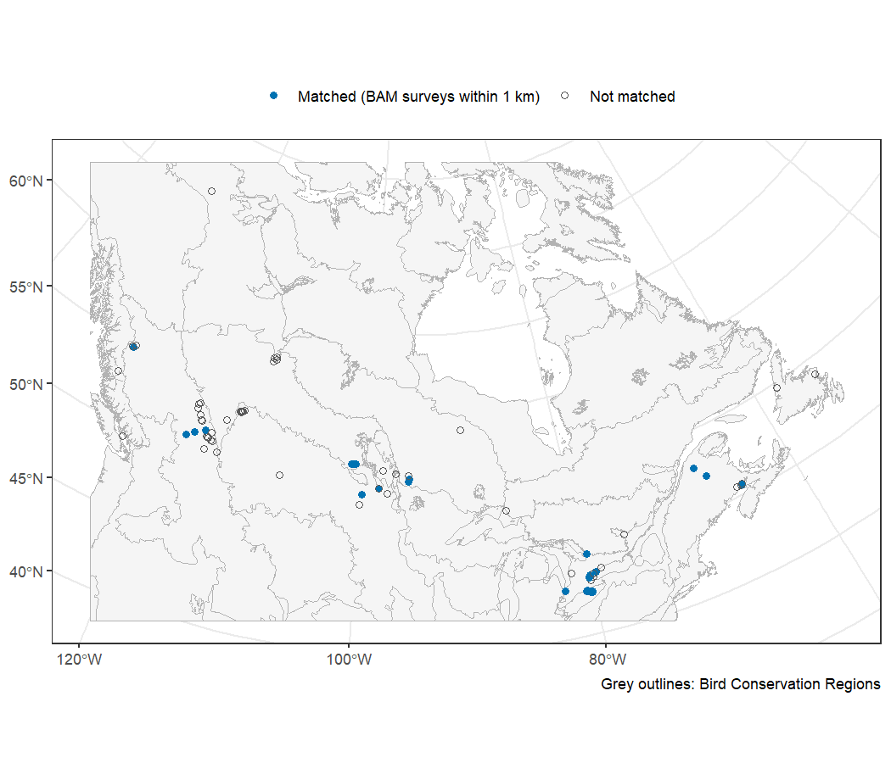
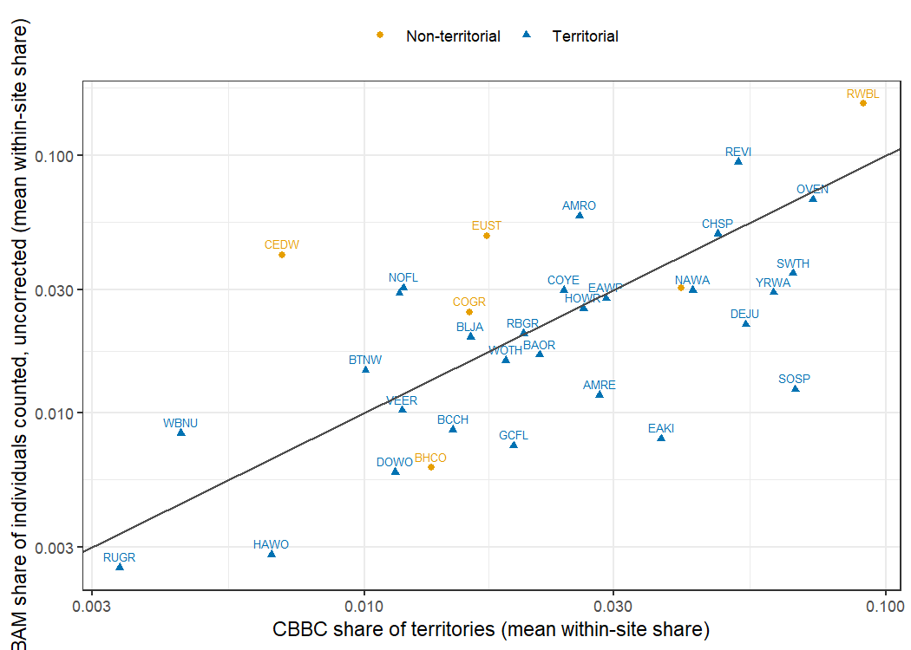
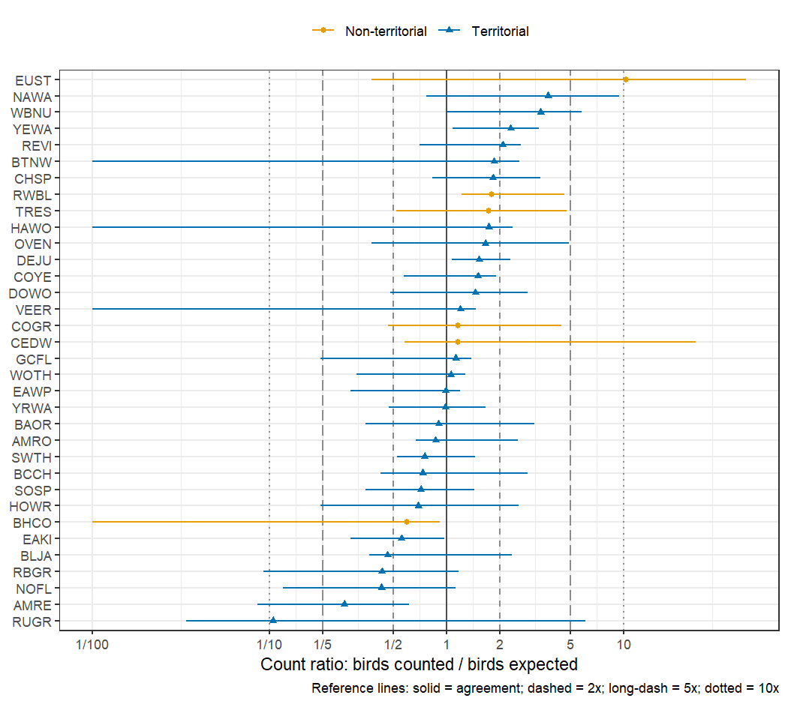
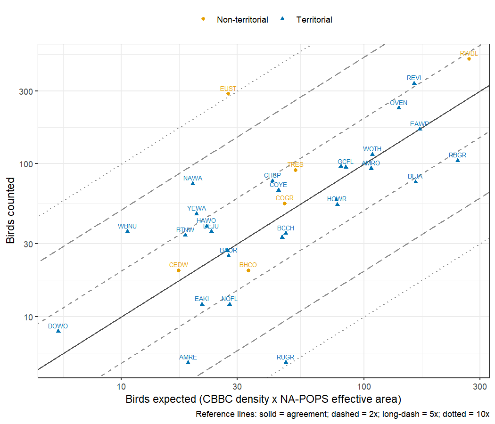
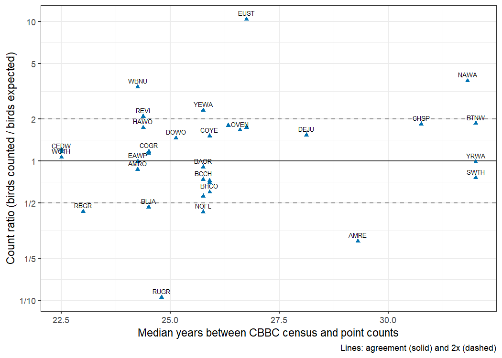
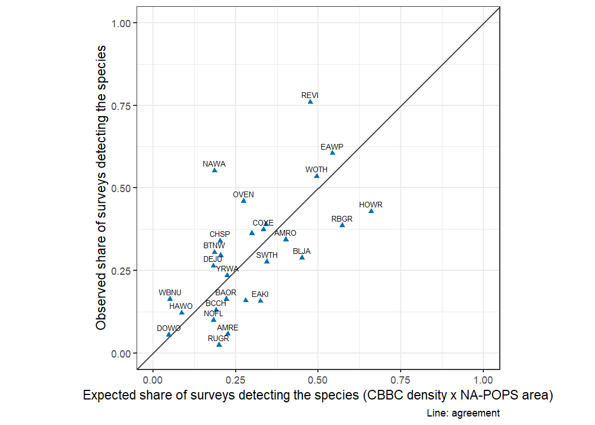

Do NA-POPS-corrected point counts reproduce spot-mapping densities?
Canadian Breeding Bird Census vs BAM
================
David Iles, assisted by Opus 5.5 and GPT-6 Sol
06 November 2026

- [1 Overview](#1-overview)
- [2 Data sources](#2-data-sources)
- [3 Repository structure and
  workflow](#3-repository-structure-and-workflow)
- [4 Reproducing the analysis](#reproducing)
- [5 Purpose and logic of this report](#purpose)
- [6 Step 1: Data support and raw
  agreement](#6-step-1-data-support-and-raw-agreement)
  - [6.1 Sample sizes](#61-sample-sizes)
  - [6.2 Replication of BAM surveys](#62-replication-of-bam-surveys)
  - [6.3 CBBC plot sizes](#63-cbbc-plot-sizes)
  - [6.4 Timing](#64-timing)
  - [6.5 Geographic representation](#65-geographic-representation)
  - [6.6 Species compared](#66-species-compared)
  - [6.7 Do the datasets agree on which species are
    common?](#67-do-the-datasets-agree-on-which-species-are-common)
- [7 Step 2: NA-POPS detectability corrections](#napops-corrections)
- [8 Step 3: CBBC vs BAM point
  counts](#8-step-3-cbbc-vs-bam-point-counts)
  - [8.1 Composition: does correction improve agreement with
    CBBC?](#81-composition-does-correction-improve-agreement-with-cbbc)
  - [8.2 How the absolute comparisons work](#absolute-logic)
  - [8.3 Count ratio: birds counted vs birds
    expected](#observed-expected)
  - [8.4 Plot-averaged density ratio: equal weight per
    plot](#plot-averaged)
  - [8.5 When the two ratios disagree](#85-when-the-two-ratios-disagree)
  - [8.6 Population change since the
    census](#86-population-change-since-the-census)
  - [8.7 Detection-rate check](#87-detection-rate-check)
  - [8.8 Which plots disagree most?](#88-which-plots-disagree-most)
- [9 Step 4: Synthesis](#9-step-4-synthesis)
- [10 Settings used](#10-settings-used)

# 1 Overview

This repository compares two ways of estimating breeding-bird density in
Canada:

- **Point counts** from the Boreal Avian Modelling (BAM) Project’s
  point-count database, converted to density with detectability
  corrections from **NA-POPS** (Point count Offsets for Population Sizes
  of North American landbirds).
- **Spot mapping** from the **Canadian Breeding Bird Census (CBBC)**, in
  which observers visited fixed plots repeatedly and mapped territories,
  giving densities that need no detectability correction.

If the NA-POPS corrections are about right, corrected point counts near
CBBC plots should give densities of the same magnitude as the CBBC
censuses. It is a plausibility check on the corrections, not a
validation of them; the limitations are set out in Section
<a href="#purpose">5</a>.

The rest of this README is the full report, generated from `README.Rmd`.
The main results across all comparisons are summarised in the synthesis
table near the end.

# 2 Data sources

None of the data are included in this repository. The scripts read them
from local paths set at the top of each script (Section
<a href="#reproducing">4</a>).

| Source | What is used | Notes |
|:---|:---|:---|
| **Canadian Breeding Bird Census (CBBC)** | `PLOTS` and `SPECIES` tables: plot location, size, habitat, census year and visits; territory counts per species | Database documented in Kennedy et al. (1999), CWS Technical Report 342. Held by Environment and Climate Change Canada (Canadian Wildlife Service). Census records are filtered for coordinate quality, list completeness, effort, plot size, year and habitat in `P1_prepare_cbbc.R`. |
| **BAM point-count database (v5)** | Human point counts (no ARU recordings, no eBird checklists) within 1 km of each retained CBBC plot, with survey date, time, duration, distance limit and counts | DuckDB build `03_BAMDataset_WT-2026-08-26_EBd-Jun-2026_PRISM-2026-10-09`. Access through the BAM Project’s data-sharing process. |
| **NA-POPS** | Species availability (removal) and distance (EDR) models | Through the [`napops`](https://github.com/na-pops/napops) R package; the results release used is reported in Section <a href="#napops-corrections">7</a>. The intercept-only distance model is used. |
| **Bird Conservation Regions** | Boundaries for the site map | Optional; the map is drawn without them if the file is absent. |

# 3 Repository structure and workflow

    spot-mapping-vs-point counts/
    ├── *.Rproj            RStudio project (sets the project root used by here::here())
    ├── README.Rmd         this report; knits to README.md and README_files/
    ├── script/            preparation scripts P1-P3
    ├── data/              local input data (not included in the repository)
    └── output/            cached outputs of P1-P3 (not included in the repository)

The analysis has three preparation scripts, each run once with its
output cached, followed by this report:

| Step | Script | Prepares | Cached output (in `output/`) |
|:---|:---|:---|:---|
| 1 | `script/P1_prepare_cbbc.R` | CBBC coordinates, census filters, densities, species-code rules (recodes, split taxa, Traill’s Flycatcher, non-territorial species) | `P1_cbbc_prepared.rds` |
| 2 | `script/P2_match_bam_surveys.R` | BAM surveys within 1 km of each retained CBBC plot, survey filters, time since sunrise, counts | `P2_bam_matched.rds` |
| 3 | `script/P3_napops_corrections.R` | Species compared, NA-POPS availability, EDR and effective area for every survey and species | `P3_napops_corrections.rds` |
| 4 | `README.Rmd` | This report, knitted to `README.md` | figures in `README_files/` |

Each script and the report define their settings as constants at the
top, and record them with their outputs; Section
<a href="#settings-used">10</a> lists the settings used for this
version.

# 4 Reproducing the analysis

1.  Open the RStudio project (the `.Rproj` file in the repository root).
    All paths inside the project are built with `here::here()`, so they
    resolve from the project root, whichever folder a script is run
    from.
2.  Place the input data in `data/`, or set the data paths at the top of
    each preparation script (CBBC tables in P1, the BAM DuckDB file in
    P2), and optionally the BCR file at the top of `README.Rmd`.
3.  Install the R packages used: `tidyverse`, `readxl`, `sf`, `DBI`,
    `duckdb`, `suncalc`, `lutz`, `napops`, `rappdirs`, `here`, `knitr`
    and `bookdown`.
4.  Run `script/P1_prepare_cbbc.R`, `script/P2_match_bam_surveys.R` and
    `script/P3_napops_corrections.R`, in that order. Each writes its
    output to `output/`. Re-run them only when their inputs or settings
    change; each later script reads the earlier ones’ outputs.
5.  Knit `README.Rmd` (in the repository root) with the Knit button.
    This writes `README.md` and its figures in `README_files/`; commit
    both so GitHub can display the report.

Because the data are not public, `README.md` shows the results of the
author’s local run.

# 5 Purpose and logic of this report

**The question.** Point counts become densities only after correcting
for birds that were present but not counted. NA-POPS supplies those
corrections: availability (the chance a bird sings during the count) and
effective detection radius (how far away singing birds are heard). If
the corrections are about right, NA-POPS-corrected point counts should
give densities close to those from an independent, more intensive
method. This report asks whether they do, using Canadian Breeding Bird
Census (CBBC) spot-mapping plots as that independent reference.

**Why spot mapping.** CBBC observers visited each plot repeatedly (at
least the minimum number of visits set in P1; Table
<a href="#tab:step1a-1">6.1</a>) and mapped territories, so CBBC
densities are territories per unit area, including fractions of
territories crossing the plot edge, with no detectability correction
involved. For territorial songbirds detected mainly by song, this is
approximately the quantity a corrected point count estimates. The two
are not identical: point counts record individuals (a pair, a fledgling
or a non-territorial bird adds to the count), whereas spot mapping
records territories. Spot mapping also misses some territories, so CBBC
is treated as an independent reference rather than the truth.

**Scope.** Species are selected on one criterion: CBBC territories at 10
or more matched sites (set in P3), plus an NA-POPS model, without which
counts cannot be corrected. Nothing about BAM detections, availability
or EDR is used, so no species is included or excluded because of how
well BAM and CBBC agree. Results are summarised for all species and for
territorial species separately, because spot mapping cannot census
colonial, flocking or non-territorial species as territories.

**Sites compared.** Every comparison between CBBC and BAM uses only
CBBC-positive grids, except the community-composition comparison in Step
1 (which needs every species measured over the same sites): for each
species, the CBBC sites where spot mapping found territories of that
species. Where spot mapping found none but nearby points counted the
species, the usual cause is that the points sample different habitat
from the plot (for example, forest around a small open or wetland plot),
so those site x species combinations say little about detectability.
Restricting to CBBC-positive grids selects grids where CBBC density was
high partly by chance, which pushes ratios of BAM to CBBC density
slightly below 1.

**What the comparison can and cannot show.** It is a plausibility check:
whether NA-POPS-corrected point counts give densities of the same
magnitude as an independent, intensive census. It cannot validate
availability and EDR separately, because detectability error is
confounded with population change since the censuses, habitat
differences between plots and nearby points, and individuals versus
territories. The 95% intervals reported below are **sampling
intervals**: they describe how much the results depend on which sites
and surveys happened to be available, taking the NA-POPS corrections and
the CBBC densities as given. They do not include uncertainty in the
corrections themselves (model choice, NA-POPS release, availability),
error in the historical CBBC densities, population change or spatial
mismatch, and should not be read as the uncertainty in the accuracy of
the corrections. Because density scales with 1 / EDR² for
unlimited-distance counts, errors in EDR dominate that uncertainty (Step
2).

**What else differs between the two datasets.** Any disagreement mixes
detectability error with three things that have nothing to do with it:

- **Time.** CBBC censuses are decades older than the BAM surveys.
  Populations have changed since, in both directions and by species.
- **Place and habitat.** BAM surveys within 1 km of a plot are not on
  the plot, and can sample different habitat.
- **What is counted.** Point counts record individuals (including pairs,
  fledglings and non-territorial birds); spot mapping records
  territories.

The report therefore moves from comparisons that are robust to these
differences toward ones that are not, and judges each in light of the
last:

1.  **Data support and raw agreement.** How much matched data there is,
    how well replicated, from when and where, and whether the two
    datasets agree on *which species are common*. No detectability
    correction and no units are involved.
2.  **NA-POPS corrections.** How large the corrections are for these
    species and what drives them.
3.  **CBBC vs BAM point counts.** Whether correction improves agreement
    in species composition, then the absolute test: the **count ratio**
    (birds counted / birds expected from CBBC densities and the NA-POPS
    corrections), checked against the **plot-averaged density ratio**,
    which weights every CBBC plot equally.
4.  **Synthesis.** What holds across comparisons.

The data are prepared by the three scripts described in Section
<a href="#repository-structure-and-workflow">3</a>, whose cached outputs
this report reads.

# 6 Step 1: Data support and raw agreement

**Question:** how much matched data is there, how well replicated, from
when and where, and do CBBC and raw BAM counts agree on which species
are common?

**Why this comes first:** every later comparison inherits the sample
sizes, the time gap and the geographic coverage described here. Weak
support or a long gap limits what any detectability comparison can show.

## 6.1 Sample sizes

**What this tests:** how many CBBC census records survive the quality
filters, and how many of the retained sites have BAM point counts close
enough to compare. Each filter is listed separately, so it is clear why
records were dropped and which filter costs the most data.

| CBBC filter                               | Records failing |
|:------------------------------------------|----------------:|
| Usable coordinates                        |               1 |
| Coordinates agree with GRIDREF (\<= 1 km) |               0 |
| Species list \>= 80% of TOTSPP            |              16 |
| Visits reported and \>= 6                 |             283 |
| Plot size reported and 10-100 ha          |             379 |
| Census year                               |             470 |
| Not successional or urban habitat         |             257 |

Table 6.1: CBBC census records failing
each filter (of 928; a record can fail several)

| BAM survey filter (cumulative)                        | CBBC sites | Surveys |
|:------------------------------------------------------|------------|--------:|
| All BAM surveys within 1 km                           | 69         |    1488 |
| Human point counts (sensor PC; ARUs excluded)         | 64         |    1135 |
| Standardized point counts (method PC; eBird excluded) | 41         |     534 |
| Breeding season (day of year 145-196)                 | 41         |     534 |
| Valid duration and distance limit                     | 41         |     534 |
| Morning (-1 to 6 h from sunrise)                      | 41         |     534 |

Table 6.2: CBBC sites with BAM surveys
within 1 km, and surveys, after each filter

| Within (m) | CBBC sites with \>= 1 retained survey |
|-----------:|--------------------------------------:|
|        250 |                                    17 |
|        500 |                                    23 |
|       1000 |                                    41 |

Table 6.3: CBBC sites with at least one
retained BAM survey within each distance of the plot coordinate

| Species list                       | Retained census records |
|:-----------------------------------|------------------------:|
| Complete (species rows \>= TOTSPP) |                     149 |

Table 6.4: Completeness of the species
lists of retained census records. A species missing from a complete list
is treated as absent; one missing from any other list is treated as
unknown

149 of 928 census records (112 sites) pass the CBBC filters, and **41
sites** have at least one retained BAM point count within 1 km. 55
retained surveys lie within 1 km of more than one plot; each survey is
assigned to its nearest plot, so no survey is used twice, and 29 sites
keep at least one assigned survey. That is the maximum sample for
site-level comparisons. Species-level comparisons pool across these
sites.

## 6.2 Replication of BAM surveys

**What this tests:** how much BAM effort stands behind each site’s
density estimate. A site with one survey, or many surveys from a single
point, has a noisy estimate. This is why the absolute comparisons below
pool sites within each species rather than comparing sites one by one.

| variable  | min | q25 | median | q75 | max |
|:----------|----:|----:|-------:|----:|----:|
| surveys   |   1 |   3 |      6 |  22 | 140 |
| locations |   1 |   2 |      3 |   7 |  19 |
| projects  |   1 |   1 |      1 |   2 |   5 |
| years     |   1 |   1 |      2 |   5 |  22 |

Table 6.5: Per matched site: retained BAM
surveys assigned to the site (nearest plot), distinct point locations,
projects and survey years

Figure 6.1: Retained BAM surveys per
matched CBBC site (log scale).

The median site has 6 surveys from 3 point location(s), and 17% of sites
have surveys from a single location. **How to read:** each site’s BAM
estimate rests on few surveys, so site-level comparisons are noisy.
Species-level ratios pooled across sites are the more robust measure.
Repeat visits to one location replicate *time*, not *space*.

## 6.3 CBBC plot sizes

**What this shows:** how large the spot-mapping plots are, compared with
the area of the 1 km circle within which BAM surveys are matched. The
larger the matching circle relative to the plot, the more the nearby
points can sample habitat that is not on the plot.

| Sites | Number of sites | Min | 25% | Median | 75% | Max | Median equivalent radius (m) |
|:---|---:|---:|---:|---:|---:|---:|---:|
| All retained sites | 112 | 10 | 10 | 12.5 | 18 | 100 | 199.4 |
| Matched sites | 41 | 10 | 10 | 12.0 | 16 | 39 | 195.4 |

Table 6.6: CBBC plot size (ha) at
all retained sites and at matched sites, and the radius of a circle with
the median plot’s area

The median matched plot is 12 ha. The 1 km matching circle covers 314
ha, about 26 times as much, so most of the area sampled by the matched
points lies off the plot.

## 6.4 Timing

**What this tests:** how far apart in time the two datasets are.
Populations change, so a long gap means CBBC densities may not describe
the community the BAM surveys sampled. The gap cannot be removed with
these data. It is the main reason disagreement for an individual species
should not be read as detectability error.

| dataset          |   n |  min |  q25 | median |  q75 |  max |
|:-----------------|----:|-----:|-----:|-------:|-----:|-----:|
| BAM point counts | 534 | 1987 | 1997 |   2004 | 2012 | 2025 |
| CBBC censuses    |  53 | 1975 | 1978 |   1980 | 1982 | 1992 |

Table 6.7: Years of CBBC censuses and BAM
surveys at matched sites

Figure 6.2: Years of BAM point counts and
CBBC censuses at matched sites.

The median gap between a site’s CBBC census year(s) and its BAM surveys
is **28 years** (IQR 24-32). **How to read:** population change over
that gap is mixed in with every density comparison below, and declines
would make BAM look *lower* than CBBC. It cannot be separated from
detectability error with these data alone.

## 6.5 Geographic representation

**What this tests:** where the matched sites are, which limits how far
the conclusions generalize.

Figure 6.3: Retained CBBC sites, by whether
they have retained BAM point counts within 1 km.

**How to read:** results describe the regions of the *matched* sites
(concentrated in southern Ontario), not Canada as a whole.

## 6.6 Species compared

**What this shows.** Which species enter the comparison. Candidates are
all species with CBBC territories at 10 or more matched sites; those
with NA-POPS models are compared. No criterion uses the observed BAM
counts, availability or EDR. Table
<a href="#tab:step1-species-2">6.8</a> shows each species’ class
(territorial or not), its 5-min availability and EDR, and the BAM count
expected if NA-POPS-corrected densities equalled CBBC densities,
alongside the count observed.

**How the expected count is calculated.** It is the total number of
birds the BAM surveys should have counted if two things were both true:
the CBBC territory densities still described the places those surveys
sampled, and the NA-POPS corrections were right. For each species:

1.  **Surveys used.** Every retained BAM survey is assigned to its
    nearest CBBC grid. The surveys used are those assigned to the
    species’ CBBC-positive grids (grids where spot mapping found
    territories of the species).
2.  **Expected count of one survey.** For survey *j* at grid *g*:
    expected*j* = *A**j* × *D**g*,
    where
    - *D**g* is the CBBC territory density at grid *g*
      (territories / km², mean over the grid’s census years);
    - *A**j* is the survey’s NA-POPS effective area (km²):
      *A**j* = *p**j* × π × EDR² × (1 −
      exp(−(*r**j* / EDR)²)) / 106;
    - *p**j* is availability, the probability that a bird
      present sings or calls during the count. It comes from the NA-POPS
      removal model and depends on the survey’s duration, day of year
      and time since sunrise;
    - EDR is the species’ effective detection radius (m), from the
      NA-POPS intercept-only distance model;
    - *r**j* is the survey’s distance limit (m). For an
      unlimited-distance count the last factor is 1, so
      *A**j* = *p**j* × π × EDR² / 106.
3.  **Totals.** The table shows the sum of expected*j* over
    the species’ surveys, next to the sum of the counts observed in the
    same surveys.

For example, a 5-min survey with *p* = 0.8, EDR = 100 m and a 100 m
distance limit has *A* = 0.8 × π × 0.1² × (1 − e−1) ≈ 0.016
km². At a grid with 20 territories / km² it is expected to count about
0.32 birds.

The calculation counts one bird per territory. Pairs, fledglings and
non-territorial birds push the observed count above it; population
declines since the census, and points sampling different habitat from
the plot, push it below. Observed / expected is the count ratio of
Section <a href="#observed-expected">8.3</a>, where it is explained in
detail and given with confidence intervals.

| species | common_name | Class | CBBC sites | Expected count | Observed count | 5-min availability | EDR (m) |
|:---|:---|:---|---:|---:|---:|---:|---:|
| RWBL | Red-winged Blackbird | Non-territorial | 21 | 271 | 485 | 0.80 | 107 |
| RBGR | Rose-breasted Grosbeak | Territorial | 13 | 243 | 105 | 0.66 | 97 |
| EAWP | Eastern Wood-Pewee | Territorial | 16 | 170 | 168 | 0.76 | 86 |
| BLJA | Blue Jay | Territorial | 16 | 163 | 76 | 0.57 | 110 |
| REVI | Red-eyed Vireo | Territorial | 17 | 161 | 335 | 0.85 | 77 |
| OVEN | Ovenbird | Territorial | 22 | 139 | 231 | 0.84 | 91 |
| WOTH | Wood Thrush | Territorial | 10 | 108 | 115 | 0.77 | 84 |
| AMRO | American Robin | Territorial | 15 | 107 | 93 | 0.73 | 95 |
| GCFL | Great Crested Flycatcher | Territorial | 16 | 84 | 95 | 0.60 | 83 |
| VEER | Veery | Territorial | 10 | 80 | 96 | 0.73 | 102 |
| HOWR | House Wren | Territorial | 11 | 78 | 54 | 0.89 | 81 |
| SWTH | Swainson’s Thrush | Territorial | 15 | 77 | 58 | 0.86 | 85 |
| TRES | Tree Swallow | Non-territorial | 10 | 52 | 91 | 0.64 | 77 |
| RUGR | Ruffed Grouse | Territorial | 11 | 48 | 5 | 0.64 | 108 |
| BCCH | Black-capped Chickadee | Territorial | 18 | 48 | 35 | 0.62 | 75 |
| COGR | Common Grackle | Non-territorial | 12 | 47 | 55 | 0.54 | 92 |
| SOSP | Song Sparrow | Territorial | 19 | 46 | 33 | 0.76 | 68 |
| COYE | Common Yellowthroat | Territorial | 14 | 45 | 67 | 0.78 | 82 |
| CHSP | Chipping Sparrow | Territorial | 18 | 42 | 77 | 0.79 | 73 |
| BHCO | Brown-headed Cowbird | Non-territorial | 15 | 33 | 20 | 0.56 | 79 |
| NOFL | Northern Flicker | Territorial | 15 | 28 | 12 | 0.56 | 125 |
| BAOR | Baltimore Oriole | Territorial | 17 | 28 | 25 | 0.51 | 86 |
| EUST | European Starling | Non-territorial | 11 | 28 | 286 | 0.55 | 104 |
| YRWA | Yellow-rumped Warbler | Territorial | 14 | 27 | 27 | 0.82 | 65 |
| DEJU | Dark-eyed Junco | Territorial | 13 | 23 | 36 | 0.78 | 63 |
| HAWO | Hairy Woodpecker | Territorial | 15 | 23 | 39 | 0.56 | 73 |
| EAKI | Eastern Kingbird | Territorial | 14 | 21 | 12 | 0.61 | 88 |
| YEWA | Yellow Warbler | Territorial | 10 | 20 | 47 | 0.79 | 73 |
| NAWA | Nashville Warbler | Territorial | 10 | 20 | 74 | 0.82 | 81 |
| AMRE | American Redstart | Territorial | 15 | 19 | 5 | 0.78 | 60 |
| BTNW | Black-throated Green Warbler | Territorial | 12 | 18 | 34 | 0.76 | 71 |
| CEDW | Cedar Waxwing | Non-territorial | 12 | 17 | 20 | 0.34 | 68 |
| WBNU | White-breasted Nuthatch | Territorial | 11 | 11 | 36 | 0.63 | 66 |
| DOWO | Downy Woodpecker | Territorial | 15 | 6 | 8 | 0.49 | 59 |

Table 6.8: Species compared: BAM
count expected if NA-POPS-corrected densities equalled CBBC densities
(CBBC-positive grids), count observed in the same surveys, 5-min
availability and EDR

34 of 34 candidate species have NA-POPS models and are compared (28
territorial, 6 non-territorial). 0 of them were never detected by a
matched BAM survey.

## 6.7 Do the datasets agree on which species are common?

**What this tests:** whether, before any correction, the two methods
rank species similarly. This is the most robust comparison in the
report: it needs no detectability correction and no units, so errors in
NA-POPS cannot affect it. Strong agreement means the datasets describe
broadly the same communities, so later absolute differences are more
likely to reflect detectability. Weak agreement means time, habitat and
method differences are large, and the absolute comparisons need more
caution.

Relative abundance is computed site by site, then averaged across sites:

1.  **Within each matched site**, each species’ share of the site’s
    community: its CBBC territory density divided by the summed density
    of all species compared at that site, and likewise its BAM
    **uncorrected** count per survey divided by the site’s summed count
    per survey. A species absent from a site has a share of 0 there.
2.  **Across sites**, each species’ shares are averaged. Only sites
    where both datasets recorded at least one of the species compared
    are used, so both averages come from the same sites.

A species whose presence at a site is unknown (missing from an
incomplete census list; Table <a href="#tab:step1a-4">6.4</a>) is left
out of that site’s shares in both datasets, so unknowns are not counted
as absences. Each site contributes equally, whatever its plot size or
density, and a few plots with exceptionally high densities of one
species (for example Bay-breasted Warbler on budworm-outbreak plots)
cannot dominate the result. Averaging summed densities instead would let
those plots set the species’ share. No detectability correction or units
are involved.

This is the one comparison in the report not restricted to CBBC-positive
grids. Composition needs every species measured over the same sites; at
CBBC-positive grids each species’ share would describe only the plots
where it was found.

| species     | n_species | pearson_log | spearman |
|:------------|----------:|------------:|---------:|
| All species |        34 |        0.63 |     0.55 |
| Territorial |        28 |        0.68 |     0.61 |

Table 6.9: Correlation across species of
CBBC and uncorrected BAM relative abundance (mean within-site shares,
all matched sites)

Figure 6.4: Mean within-site share of CBBC
territories vs mean within-site share of BAM individuals counted
(uncorrected), by species, across all matched sites. Line: equal shares.

Shares are averaged over 28 matched sites. Across species, CBBC and
uncorrected BAM relative abundances have Spearman ρ = **0.55** (Pearson
on log scale 0.63). Within individual sites, the median rank correlation
across species is 0.43 (28 sites). **How to read:** a strong
species-level correlation means the datasets broadly agree on community
composition before any correction. Species far off the 1:1 line in
Figure <a href="#fig:step1e">6.4</a> are the candidates for
detectability or methodological differences: loud, far-detected species
should sit *above* it (over-represented in counts), and quiet or
short-range species *below*.

# 7 Step 2: NA-POPS detectability corrections

**Question:** how large are the NA-POPS corrections for these species
and surveys, and what drives them?

**What this tests:** this step does not compare with CBBC. It sets
expectations for step 3: a correction can only change agreement with
CBBC as much as it varies between species, and the absolute comparisons
are only as reliable as the least certain part of the correction.

Each survey’s effective area is p × π × EDR² × (1 − exp(−(r/EDR)²)).
Availability p comes from the best NA-POPS removal model (duration, day
of year, time since sunrise). EDR comes from the NA-POPS intercept-only
distance model: one EDR per species, averaged over the habitats and road
types in the NA-POPS training data. Habitat-specific EDRs, using forest
cover around each survey, changed densities by a median of about 3%, so
they are not used. Each species’ availability and EDR are shown in Table
<a href="#tab:step1-species-2">6.8</a>.

NA-POPS results release: **2024-03-05**.

| Key feature of the corrections | Value |
|:---|:---|
| Spread of median effective area across species (max / min) | 5.6 |
| Share of variance in log effective area due to species identity | 71% |
| Share of between-species variance in log(p x EDR^2) from EDR | 77% |
| Spearman rank correlation, uncorrected vs corrected species abundance | 0.92 |
| Median width of density 95% interval from EDR sampling error alone (factor; excludes model, release and availability uncertainty) | 1.02 |
| Median share of surveys outside NA-POPS training range | 0% |

Table 7.1: Key features of the
NA-POPS corrections for the species compared

**How to read:**

- **Spread across species.** The corrections differ about 6-fold between
  species, so they can substantially re-order species. A rank
  correlation of 0.92 between uncorrected and corrected abundance shows
  how much they actually do.
- **Within vs between species.** Species identity explains 71% of the
  variation in effective area. With one EDR per species, the variation
  within a species comes only from availability (survey duration, date
  and time) and the distance limit. The corrections therefore act mostly
  *between* species (composition and absolute level), and barely change
  how sites rank *within* a species.
- **EDR dominates.** EDR enters squared, and accounts for 77% of the
  between-species variation, so errors in EDR matter most.
- **Precision.** EDR *sampling* error alone gives each species’ density
  a 95% interval spanning a factor of only about 1.02. That greatly
  understates the real uncertainty, which also includes the choice of
  distance model, availability, and the NA-POPS release (which has
  shifted closed-forest EDRs by up to ~25% between releases). For an
  unlimited-distance count, density scales with 1 / EDR², so a 25%
  larger EDR lowers density by 1 − 1/1.25² ≈ 36%, and every comparison
  with CBBC would shift by about that factor.

# 8 Step 3: CBBC vs BAM point counts

**Question:** do BAM point counts agree with CBBC, first in composition
(with and without correction) and then in absolute density after
correction? Where do they disagree?

**Structure:** composition first (does correction move the species mix
toward CBBC?), then an explanation of how the absolute comparisons work,
then the two absolute comparisons themselves: the count ratio (main
result) and the plot-averaged density ratio (check on how plots are
weighted). Population change, a detection-rate check and the site
characteristics associated with disagreement follow.

## 8.1 Composition: does correction improve agreement with CBBC?

**What this tests:** whether applying the NA-POPS corrections makes the
BAM species composition more like CBBC’s. This tests the corrections’
*relative* values between species (for example, that a quiet species
needs a larger correction than a loud one), independent of their
absolute level. If the corrections were noise, agreement would not
improve.

| BAM point counts         | n_species | pearson_log | spearman |
|:-------------------------|----------:|------------:|---------:|
| Uncorrected, all         |        34 |        0.48 |     0.53 |
| Corrected, all           |        34 |        0.46 |     0.44 |
| Uncorrected, territorial |        28 |        0.61 |     0.53 |
| Corrected, territorial   |        28 |        0.63 |     0.47 |

Table 8.1: Correlation across species of
CBBC density with BAM point counts

| measure     |   lcl |  ucl |
|:------------|------:|-----:|
| pearson_log | -0.17 | 0.16 |
| spearman    | -0.26 | 0.10 |

Table 8.2: Territorial species: 95%
bootstrap CI for the change in correlation with CBBC, corrected minus
uncorrected

Figure 8.1: CBBC density vs uncorrected
(left) and NA-POPS-corrected (right) BAM point counts, species means at
CBBC-positive grids.

**How to read:** if the corrected correlation with CBBC is higher,
NA-POPS moves species’ relative abundances toward the census. That is
independent support for the corrections, separate from their absolute
level.

## 8.2 How the absolute comparisons work

The absolute comparisons below use no statistical model. They compare
the birds the BAM surveys actually counted with the birds they should
have counted if CBBC densities and the NA-POPS corrections were both
right. This section explains the logic, with a small invented example,
before the results.

### 8.2.1 The question

NA-POPS turns a point count into a density by dividing the count by the
area the survey effectively sampled. Turn that around: if we knew the
true density at a place, we could predict how many birds a point count
there *should* record. The comparisons ask how close the counts come to
that prediction. For a survey *j* assigned to CBBC grid *g*, the working
assumption is

> E$$count~*j*~$$ = *k* × *A**j* × *D**g*

where *D**g* is the CBBC territory density at the grid
(territories / km²), *A**j* is the survey’s NA-POPS effective
area (km²), and *k* is a single number per species. If the CBBC
densities still describe the area the points sample, and the NA-POPS
corrections are right, then *k* = 1. If *k* = 2, the point counts
recorded twice as many birds as CBBC density and NA-POPS together
predict.

### 8.2.2 The ingredients

**CBBC density, *D**g*.** Territories on the plot divided by
plot area (× 100 to convert from ha to km²). A plot with 3 territories
on 10 ha has *D* = 30 territories / km². If a grid was censused in
several years, *D**g* is the mean across those years. Only
grids where CBBC found the species are used (its CBBC-positive grids).

**Effective area, *A**j*.** The area within which the survey
would have detected every bird if detection were perfect. It combines
availability (the chance a bird sings or calls during the count, which
depends on the count’s duration, date and time of day), the species’
effective detection radius (EDR), and the survey’s distance limit; the
formula is in Section <a href="#species-compared">6.6</a>. For a species
with EDR = 80 m, a 5-min unlimited-distance count with availability 0.8
has *A* = 0.8 × π × 0.08² ≈ 0.016 km² (about 1.6 ha). The same count
truncated at 50 m has *A* ≈ 0.005 km², because only 1 − exp(−(50/80)²) ≈
32% of the effective area lies within 50 m. That truncated count is
*expected* to record about a third as many birds, which is exactly what
truncation does to the observed count, so surveys run under different
protocols are put on the same footing.

**Which surveys go with which grid.** Every retained BAM survey within 1
km of a CBBC plot is assigned to the nearest plot, so a survey within 1
km of two plots is counted once, never twice.

### 8.2.3 From counts to the count ratio

For each species:

1.  **Expected count of each survey:** *E**j* =
    *A**j* × *D**g*.
2.  **Totals:** sum the expected counts over all the species’ surveys,
    and sum the observed counts over the same surveys.
3.  **Count ratio:** *k* = Σ observed / Σ expected.

The ratio of totals is not an arbitrary choice. If counts are Poisson
with mean *k* × *E**j*, the log-likelihood is Σ
$$*O*~*j*~ log(*k
E*~*j*~) − *k E*~*j*~$$, and setting its derivative to zero gives *k* =
Σ*O**j* / Σ*E**j*: the ratio of totals is the
maximum-likelihood estimate. Overdispersion (pairs or family groups
counted together, clumped birds) does not bias it; it only makes it less
precise, which the confidence intervals below take into account.
Averaging each survey’s own ratio instead would fail badly: most surveys
record none of a given species against expected counts of a fraction of
a bird, so their individual ratios would be 0, or very large when a
single bird turned up.

### 8.2.4 A worked example

An invented species, with *A* ≈ 0.016 km² for every survey (in the real
data *A* varies a little between surveys):

| Grid | Plot size | Territories on plot | *D* (/ km²) | Surveys | Expected | Observed | Grid ratio |
|:---|:---|:---|:---|:---|:---|:---|:---|
| G1 | 10 ha | 3 | 30 | 2 | 2 × 0.016 × 30 = 0.96 | 1 | 1.04 |
| G2 | 100 ha | 15 | 15 | 40 | 40 × 0.016 × 15 = 9.60 | 20 | 2.08 |
| G3 | 40 ha | 4 | 10 | 8 | 8 × 0.016 × 10 = 1.28 | 1 | 0.78 |
| **Total** |  |  |  | 50 | **11.84** | **22** | ***k* = 1.86** |

The species’ count ratio (1.86) is close to G2’s ratio (2.08), even
though G1 and G3 both suggest agreement. The reason is visible if *k* is
rewritten as a weighted average of the grid ratios, *k* =
Σ*g* *w**g* *k**g*, where each grid’s
weight *w**g* is its share of the total expected count: 8%
for G1, 81% for G2 and 11% for G3. A grid’s expected count is (number of
surveys) × (effective area) × (CBBC density), so **a grid’s influence on
the count ratio is proportional to its survey effort multiplied by its
CBBC density.**

### 8.2.5 CBBC plots of very different sizes

Plot size does **not** weight the count ratio directly. It enters only
through density, which already divides territories by plot area. In the
example, G1 (10 ha) and G2 (100 ha) are weighted by their surveys and
densities, not their sizes: had G1 been a 100 ha plot with 30
territories, its density, and everything downstream, would be unchanged.
That is usually what we want, because the BAM surveys sample the 1 km
circle around a plot (about 314 ha) regardless of how large the plot is.

Plot size still matters in three ways that the count ratio does not
adjust for, because it treats CBBC density as known:

- **Precision of the density.** On a 10 ha plot, one territory more or
  less changes density by 10 / km², so G1’s 30 / km² could easily have
  been 20 or 40. On a 100 ha plot, one territory changes density by 1 /
  km².
- **Edge effects.** Territories straddling the plot boundary are counted
  as fractions, and a “+” (part of a territory) is coded as 0.1
  territory, which on a 10 ha plot is 1 territory / km² on its own.
  Small plots tend to overstate density because edge territories make up
  a larger share of them.
- **Habitat match.** A 10 ha plot is about 3% of the 1 km matching
  circle, so the points around it can easily sample habitat the plot
  does not represent; a 100 ha plot covers about a third of the circle
  (Table <a href="#tab:step1-plots-1">6.6</a>).

So small plots bring noisier, possibly inflated and less representative
densities into the count ratio, but no extra weight. This is why P1
drops plots under 10 ha, and why plot size is a term in the site-level
regression below.

### 8.2.6 CBBC plots with very different numbers of point counts

Survey effort **does** weight the count ratio directly: doubling the
surveys at a grid doubles both its observed and expected totals, and so
doubles its weight. That is reasonable when the extra surveys carry
extra information (more points spread around the plot, or more years),
and less so when they mostly repeat the same few points. In these data
the busiest CBBC site has well over 100 retained surveys while the
median site has a handful (Table <a href="#tab:step1b-1">6.5</a>), so
one site can decide a species’ count ratio almost on its own, as G2 does
in the example. The per-species table below therefore reports the share
of each species’ expected count that comes from its single largest site.

Repeat visits to the same point are not independent either: the same
territorial birds are counted visit after visit, so 40 surveys at G2 may
amount to a few independent samples of the birds around one location.
This does not bias the count ratio, but a naive Poisson standard error
would be far too small. The 95% sampling intervals therefore start from
a **site bootstrap**:

1.  Draw sites at random, with replacement, as many as the species has.
2.  Keep *all* of each drawn site’s surveys together, so repeat visits
    and nearby points move as a block.
3.  Recompute the count ratio for that resample.
4.  Repeat 1000 times; the 2.5th and 97.5th percentiles of the resampled
    ratios form the 95% interval.

Because whole sites are resampled, the interval reflects how much the
result depends on which sites happened to be surveyed, including
clustering and overdispersion. It also exposes dominance by one site. In
the example, about 30% of resamples contain no copy of G2 ((2/3)³), and
in those the count ratio comes from G1 and G3 alone, about 2 / 2.24 ≈
0.9; resamples containing G2, sometimes twice, give about 2. The
bootstrap distribution has two peaks and the interval becomes wide and
lopsided, sometimes with the point estimate near one end. With fewer
than about 10 sites, or one dominant site, treat the interval as a rough
guide rather than a reliable 95% interval.

The bootstrap breaks down when few or no birds were counted. If no site
recorded the species, every resample gives a count ratio of 0, and the
interval collapses to 0–0 even though, say, 20 birds were expected; a
zero count is still consistent with a true ratio above 0. So the
reported interval is the wider of the bootstrap interval and the **exact
Poisson interval** for the total count, divided by the expected count.
With no birds counted, the exact Poisson upper bound on the total is
about 3.7 birds, so with 20 expected the upper bound of the count ratio
is about 0.18. The Poisson interval ignores clustering, which is why it
is used only to widen the bootstrap interval, never to narrow it.

### 8.2.7 Two ways to weight plots

The second absolute comparison, the **plot-averaged density ratio**,
weights plots differently. It first converts each grid’s counts to a
corrected density (Σ count / Σ effective area at that grid), then
divides the mean of those densities across grids by the mean CBBC
density across the same grids. This works out to a weighted average of
the grid ratios with weights proportional to CBBC density alone,
ignoring survey effort:

| Comparison | Weights (G1 / G2 / G3) | Result in the example |
|:---|:---|:---|
| Count ratio | 8% / 81% / 11% (survey effort × CBBC density) | 1.86 |
| Plot-averaged density ratio | 55% / 27% / 18% (CBBC density only) | (31.3 + 31.3 + 7.8) / (30 + 15 + 10) ≈ 1.28 |

Neither weighting is wrong; they answer slightly different questions.
The **count ratio** asks whether, across all the counting that was done,
the counts matched the prediction; it uses the survey effort
efficiently, but one heavily surveyed site can dominate it. The
**plot-averaged density ratio** asks whether, taking the CBBC plots one
at a time, corrected densities matched; a plot with 2 surveys counts as
much as one with 100, so it is noisier, but no single site can dominate
it through effort alone. When the two differ by more than about 2× for a
species, one or two heavily surveyed sites are driving the count ratio,
and that species’ result should be read with caution.

### 8.2.8 What the ratios do and do not tell you

A ratio of 1 means NA-POPS-corrected counts reproduce CBBC territory
densities on average for that species. It does not, on its own, show
that availability and EDR are right, because other things move the
ratios:

- **Above 1:** pairs, fledglings and non-territorial birds add to counts
  but not to territories, and spot mapping misses some territories.
- **Below 1:** population declines since the censuses, and using only
  CBBC-positive grids, which selects grids where CBBC density was high
  partly by chance.

The detection-rate check below complements both ratios, because it
compares how often surveys detect the species at all, which pairs and
family groups do not inflate.

The intervals around both ratios are sampling intervals: they take the
NA-POPS corrections and the CBBC densities as given. Errors in the
corrections, above all in EDR, move every species’ ratio together, by an
amount the intervals do not show (Step 2).

## 8.3 Count ratio: birds counted vs birds expected

**What this shows.** For each species, the total number of birds counted
by its surveys divided by the total expected from CBBC density and each
survey’s NA-POPS effective area (the observed and expected counts of
Table <a href="#tab:step1-species-2">6.8</a>). This is the main absolute
comparison in the report.

| Species | Number of species | Median count ratio | Median fold difference (either direction) | Share within 2x | Share within 5x | Species with no birds counted |
|:---|----|---:|---:|---:|---:|---:|
| Territorial | 28 | 1.03 | 1.60 | 0.68 | 0.96 | 0 |
| All species | 34 | 1.14 | 1.67 | 0.71 | 0.94 | 0 |

Table 8.3: Count ratio (birds
counted / birds expected): median across species, median fold difference
from agreement in either direction, and share of species within 2x and
5x of agreement

| species | CBBC-positive sites | Surveys | Birds counted | Birds expected | Count ratio (95% sampling interval) | Largest site’s share of expected |
|:---|---:|---:|---:|---:|:---|:---|
| RUGR | 6 | 208 | 5 | 47.6 | 0.10 (0.03-6.09) | 91% |
| AMRE | 6 | 70 | 5 | 18.9 | 0.27 (0.09-0.62) | 46% |
| NOFL | 11 | 121 | 12 | 27.9 | 0.43 (0.12-1.13) | 36% |
| RBGR | 9 | 220 | 105 | 243.2 | 0.43 (0.09-1.17) | 93% |
| BLJA | 11 | 229 | 76 | 163.2 | 0.47 (0.37-2.34) | 92% |
| EAKI | 9 | 51 | 12 | 21.5 | 0.56 (0.29-0.98) | 32% |
| HOWR | 8 | 56 | 54 | 77.7 | 0.70 (0.20-2.55) | 48% |
| SOSP | 14 | 126 | 33 | 45.9 | 0.72 (0.35-1.43) | 25% |
| BCCH | 13 | 216 | 35 | 47.5 | 0.74 (0.42-2.89) | 90% |
| SWTH | 10 | 159 | 58 | 76.8 | 0.75 (0.53-1.45) | 44% |
| AMRO | 11 | 207 | 93 | 107.1 | 0.87 (0.68-2.53) | 69% |
| BAOR | 11 | 92 | 25 | 27.7 | 0.90 (0.35-3.14) | 36% |
| YRWA | 6 | 98 | 27 | 27.4 | 0.99 (0.47-1.67) | 42% |
| EAWP | 11 | 210 | 168 | 169.8 | 0.99 (0.29-1.19) | 72% |
| WOTH | 7 | 157 | 115 | 108.3 | 1.06 (0.31-1.27) | 93% |
| GCFL | 11 | 229 | 95 | 84.1 | 1.13 (0.19-1.38) | 76% |
| VEER | 5 | 190 | 96 | 80.2 | 1.20 (0.00-1.46) | 79% |
| DOWO | 10 | 110 | 8 | 5.5 | 1.45 (0.48-2.86) | 31% |
| COYE | 10 | 99 | 67 | 44.5 | 1.51 (0.57-1.91) | 36% |
| DEJU | 7 | 110 | 36 | 23.5 | 1.53 (1.07-2.30) | 57% |
| OVEN | 13 | 315 | 231 | 139.0 | 1.66 (0.38-4.94) | 36% |
| HAWO | 10 | 248 | 39 | 22.5 | 1.73 (0.00-2.37) | 82% |
| CHSP | 12 | 174 | 77 | 42.0 | 1.83 (0.83-3.41) | 37% |
| BTNW | 6 | 82 | 34 | 18.3 | 1.86 (0.00-2.59) | 63% |
| REVI | 12 | 233 | 335 | 161.0 | 2.08 (0.71-2.63) | 62% |
| YEWA | 7 | 78 | 47 | 20.4 | 2.30 (1.08-3.32) | 30% |
| WBNU | 7 | 202 | 36 | 10.6 | 3.40 (1.01-5.80) | 75% |
| NAWA | 6 | 96 | 74 | 19.7 | 3.76 (0.77-9.42) | 61% |

Table 8.4: Count ratio by
territorial species, with its 95% sampling interval (wider of the site
bootstrap and the exact Poisson interval), and the share of the expected
count contributed by the species’ single largest site (a large share
means one site dominates the ratio)

Figure 8.2: Count ratio
(birds counted / birds expected) by species, with 95% sampling
intervals. Species with no birds counted cannot be shown on the log
scale.

Figure 8.3: Birds counted vs
birds expected, by species (totals over each species’ surveys at its
CBBC-positive grids).

For territorial species, the median count ratio is **1.03**, with 68% of
species within 2× of agreement and a median fold difference of 1.6 in
either direction.

**How to read:**

- **Systematic bias vs scatter.** The median count ratio shows whether
  counts run systematically above or below what CBBC densities and
  NA-POPS predict; the median fold difference shows how far individual
  species typically are from agreement in either direction. A median
  near 1 with large scatter means no overall bias but poor species-level
  agreement.
- **Dominant sites.** Where one site supplies most of a species’
  expected count, its ratio mostly reflects that site, and its interval
  is unreliable (see the explanation above). Compare with the
  plot-averaged density ratio in Section
  <a href="#plot-averaged">8.4</a>.
- **Species far from 1** are better explained by species-specific
  population change since the census (for example, spruce budworm
  specialists such as Bay-breasted and Cape May Warblers, abundant
  during 1970s–80s outbreaks) than by detectability, which would affect
  related species similarly.

## 8.4 Plot-averaged density ratio: equal weight per plot

**What this shows.** For each species, the mean NA-POPS-corrected
point-count density across its CBBC-positive grids, divided by the mean
CBBC density over the same grids. Each plot contributes equally, however
many surveys it has, so this checks whether the count ratio is being
driven by a few heavily surveyed sites. Both ratios use the same surveys
at each plot (each survey assigned to its nearest plot), so differences
between them come from how plots are weighted. Intervals come from the
site bootstrap alone; a species with no birds counted gets a ratio of 0
with a degenerate interval here, so use its count-ratio interval
instead.

| Species | Number of species | Median density ratio | Share within 2x | Share within 5x | Share within 10x | Median Spearman across plots |
|:---|----|---:|---:|---:|---:|----|
| Territorial | 28 | 1.03 | 0.75 | 1.00 | 1.00 | 0.29 |
| All species | 34 | 1.11 | 0.68 | 0.91 | 0.91 | 0.29 |

Table 8.5: Plot-averaged
density ratio (corrected point-count density / CBBC density): median
across species, share of species within 2x, 5x and 10x, and median
within-species Spearman correlation across plots

Figure 8.4: Plot-averaged
density ratio (corrected point-count density / CBBC density) by species,
with 95% site-bootstrap sampling intervals.

Figure 8.5: Species mean
densities at CBBC-positive grids: NA-POPS-corrected point counts vs
CBBC.

For territorial species, the median plot-averaged density ratio is
**1.03**, with 75% of species within 2× and 100% within 10×.

## 8.5 When the two ratios disagree

**What this shows.** Species whose count ratio and plot-averaged density
ratio differ by more than 2×. For these, the two ways of weighting plots
give different answers, usually because one or two heavily surveyed
sites dominate the count ratio.

Figure 8.6: Count ratio vs
plot-averaged density ratio, by species. Line: the two ratios agree;
dashed lines: 2x apart.

| species | CBBC-positive sites | Count ratio | Plot-averaged density ratio | Largest site’s share of expected |
|:---|---:|---:|---:|:---|
| CEDW | 7 | 1.16 | 15.18 | 95% |
| RUGR | 6 | 0.10 | 0.69 | 91% |
| BHCO | 10 | 0.60 | 0.10 | 65% |
| HAWO | 10 | 1.73 | 0.38 | 82% |
| OVEN | 13 | 1.66 | 0.42 | 36% |
| VEER | 5 | 1.20 | 0.42 | 79% |
| EUST | 8 | 10.37 | 28.27 | 34% |
| GCFL | 11 | 1.13 | 0.49 | 76% |
| AMRO | 11 | 0.87 | 1.89 | 69% |
| BCCH | 13 | 0.74 | 1.60 | 90% |

Table 8.6: Species whose
count ratio and plot-averaged density ratio differ by more than 2x, with
the share of the expected count contributed by the species’ largest site

**How to read:** points near the line mean the result does not depend on
how plots are weighted. Species in the table deserve caution: if one
site supplies a large share of the expected count, the count ratio
mostly describes that site, and the plot-averaged density ratio is the
fairer summary of the species.

## 8.6 Population change since the census

**What this tests.** Whether the disagreement for each species follows
the time between the census and the point counts. This matters most for
the question of whether QPAD inflates density. If a species declined by
30% after its census, a correct QPAD estimate would sit at about 0.7×
the CBBC density, and a ratio of 1 would itself indicate inflation.
Population change therefore masks QPAD inflation for declining species
and exaggerates it for increasing ones.

Figure 8.7: Count ratio vs median years
between the CBBC census and the point counts, by species.

**How to read:** a trend in the count ratio with years since the census
points to population change (or changing census methods) rather than
detectability. The time gap alone cannot separate the two: correcting
for it would need each species’ population trend over the
census-to-survey period.

## 8.7 Detection-rate check

**What this tests.** A second check that is insensitive to how many
birds were recorded per detection. If CBBC density and the NA-POPS
corrections were both right, a survey with effective area *a* would
detect the species (count at least one bird) with probability 1 −
exp(−DCBBC × *a*). The observed share of surveys detecting
the species is compared with this expectation. It is evaluated per
survey, not per grid, because repeat visits to the same point re-survey
the same birds.

| n_species | median_detect_obs | median_detect_exp | median_obs_over_exp | share_obs_below_exp |
|---:|---:|---:|---:|---:|
| 28 | 0.29 | 0.25 | 1.1 | 0.43 |

Table 8.7: Detection-rate check
at CBBC-positive grids (territorial species): observed vs expected share
of surveys detecting the species

Figure 8.8: Detection-rate check,
territorial species at CBBC-positive grids: observed vs expected share
of surveys detecting the species.

At CBBC-positive grids, surveys detected species a median 29% of the
time, against 25% expected.

**How to read:** if the detection rate matches expectation while the
count ratio is above 1, the excess comes from more birds per detection
(pairs, family groups), not from the detection probabilities. If surveys
detect species less often than expected, they are sampling other
habitat, the species has declined, or birds are more clumped than a
Poisson count assumes (which lowers the chance of detecting at least one
bird for the same mean count).

## 8.8 Which plots disagree most?

**What this tests:** which site characteristics are associated with
larger disagreement:

- plot size (a control; see below for why it cannot be read as an edge
  effect);
- census effort (visits per census);
- census year (older census methods, or population change).

Each site’s community ratio sums the territorial species CBBC found
there: summed NA-POPS-corrected BAM density divided by summed CBBC
density.

|                          | Estimate | Std. Error | t value | Pr(\>\|t\|) |
|--------------------------|---------:|------------|--------:|------------:|
| (Intercept)              |   -5.952 | 2.733      |  -2.178 |       0.040 |
| log(visits_mean)         |    0.463 | 0.970      |   0.478 |       0.637 |
| log(plot_ha)             |    1.952 | 0.659      |   2.962 |       0.007 |
| I(cbbc_year_mean - 1975) |   -0.002 | 0.037      |  -0.046 |       0.964 |

Table 8.8: log(site community ratio,
corrected BAM / CBBC) ~ census visits + plot size + census year (centred
on 1975)

| Sites used | Number of sites | log(plot size) estimate | Std. Error | Pr(\>\|t\|) |
|:---|---:|---:|---:|---:|
| All sites | 27 | 1.952 | 0.659 | 0.007 |
| Plots \<= 16 ha | 23 | 0.045 | 0.727 | 0.951 |

Table 8.9: Leverage check: log(plot size)
coefficient with all sites and without plots larger than 16 ha

**How to read:** these terms capture remaining CBBC census-quality
effects (coverage, older methods) and population change since the
census.

- **Plot size is a control, not a measured edge effect.** Most matched
  plots are 10–16 ha (Table <a href="#tab:step1-plots-1">6.6</a>):
  squares with sides of about 316 to 400 m. Over that range the share of
  a plot lying within one territory radius of its edge changes only
  modestly (about 53% to 44% for territories 100 m across), so a genuine
  edge effect could not change the ratio by more than a little. A large
  plot-size coefficient is therefore more likely to reflect a few larger
  plots with high leverage, or plots of different sizes differing in
  habitat, region or era. Table <a href="#tab:step3c-2">8.9</a> shows
  how much the coefficient depends on the plots larger than 16 ha. Any
  tendency to over-count edge territories affects almost every matched
  plot similarly, so it cannot be estimated from these plot sizes.
- **Plot habitat is not included:** restricting to CBBC-positive grids
  removes most of the habitat mismatch between plots and nearby points,
  which showed up as BAM detections of species absent from the plot.
- **Matching radius.** The 1 km matching radius was chosen over 2 km
  because density declined about 11% from 0-1 km to 1-2 km at the same
  sites, as habitat shifted away from the plot’s.

# 9 Step 4: Synthesis

| Step | Comparison | Metric | Value |
|:---|:---|:---|:---|
| 1 | CBBC vs BAM uncorrected (composition, all species, all matched sites) | Spearman, species shares | 0.55 |
| 3 | CBBC vs BAM corrected (composition, all species) | Spearman, species means | 0.44 |
| 3 | Count ratio: birds counted / birds expected (territorial) | Median ratio | 1.03 |
| 3 | Count ratio: birds counted / birds expected (territorial) | Median fold difference (either direction) | 1.60 |
| 3 | Count ratio: birds counted / birds expected (territorial) | Share within 2x | 68% |
| 3 | Plot-averaged density ratio (territorial) | Median ratio | 1.03 |
| 3 | Plot-averaged density ratio (territorial) | Share within 2x / 10x | 75% / 100% |
| 3 | Detection-rate check (territorial) | Observed / expected, median | 1.10 |

Table 9.1: Key results across steps
(comparisons at CBBC-positive grids, except the step 1 composition
comparison)

**Reading across the steps:** an inference is robust if it holds in
unitless comparisons (composition, steps 1 and 3) *and* in absolute ones
(the count ratio and the plot-averaged density ratio), and is not
explained by the support or timing issues identified along the way. The
count ratio is the main absolute measure: it needs no statistical model,
is the maximum-likelihood estimate under a simple Poisson assumption,
and its sampling intervals reflect clustering and overdispersion (but
not uncertainty in the corrections, which is dominated by EDR; Step 2).
The plot-averaged density ratio shows whether a species’ result depends
on a few heavily surveyed sites, and the detection-rate check is
insensitive to how many birds were recorded per detection.

# 10 Settings used

    ## List of 3
    ##  $ P1:List of 18
    ##   ..$ coord_max_disagree_m : num 1000
    ##   ..$ require_seconds      : logi FALSE
    ##   ..$ list_completeness_min: num 0.8
    ##   ..$ min_visits           : num 6
    ##   ..$ min_plot_ha          : num 10
    ##   ..$ max_plot_ha          : num 100
    ##   ..$ min_census_year      : num 1975
    ##   ..$ successional_pattern : chr "^(44|434|[12]\\d[34]|315[34])"
    ##   ..$ exclude_successional : logi TRUE
    ##   ..$ exclude_urban        : logi TRUE
    ##   ..$ cbbc_density         : chr "PLOTDENS / PLOTSIZE x 100; DENSKM2 = 0.1 as '+'; else DENSKM2"
    ##   ..$ cbbc_recode          : Named chr [1:14] "YRWA" "YRWA" "CAJA" "CAJA" "NOFL" "NOFL" "DEJU" "DEJU" "YEWA" "BTNW" ...
    ##   ..$ bam_recode           : Named chr [1:2] "HOWR" "PSFL"
    ##   ..$ split_taxa           : Named num [1:3] -101 -114 56
    ##   ..$ traill_code          : chr "TRFL"
    ##   ..$ traill_species       : chr [1:2] "ALFL" "WIFL"
    ##   ..$ exclude_species      : chr [1:23] "BHCO" "COGR" "EUST" "HOSP" "ROPI" "RWBL" "BRBL" "YHBL" "CEDW" "AMGO" ...
    ##   ..$ created              : POSIXct[1:1], format: "2026-11-06 15:01:27"
    ##  $ P2:List of 9
    ##   ..$ bam_db         : chr "03_BAMDataset_WT-2026-08-26_EBd-Jun-2026_PRISM-2026-10-09.duckdb"
    ##   ..$ visit_filter   : chr "NOT flag_any AND NOT flag_dup"
    ##   ..$ match_radius_m : num 1000
    ##   ..$ sensors        : chr "PC"
    ##   ..$ methods        : chr "PC"
    ##   ..$ doy_range      : num [1:2] 145 196
    ##   ..$ tssr_range     : num [1:2] -1 6
    ##   ..$ distance_method: chr "haversine, R = 6371008.8 m"
    ##   ..$ created        : POSIXct[1:1], format: "2026-11-06 15:02:07"
    ##  $ P3:List of 8
    ##   ..$ min_sites_cbbc  : num 10
    ##   ..$ avail_model     : chr "best"
    ##   ..$ edr_model       : num 1
    ##   ..$ edr_quantiles   : num [1:2] 0.025 0.975
    ##   ..$ edr_samples     : num 1000
    ##   ..$ napops_version  : chr "1.1.2"
    ##   ..$ napops_data_date: chr "2024-03-05"
    ##   ..$ created         : POSIXct[1:1], format: "2026-11-06 15:02:58"

    ## R version 4.5.2 (2025-10-31 ucrt)
    ## Platform: x86_64-w64-mingw32/x64
    ## Running under: Windows 11 x64 (build 26200)
    ## 
    ## Matrix products: default
    ##   LAPACK version 3.12.1
    ## 
    ## locale:
    ## [1] LC_COLLATE=English_United States.utf8 
    ## [2] LC_CTYPE=English_United States.utf8   
    ## [3] LC_MONETARY=English_United States.utf8
    ## [4] LC_NUMERIC=C                          
    ## [5] LC_TIME=English_United States.utf8    
    ## 
    ## time zone: America/New_York
    ## tzcode source: internal
    ## 
    ## attached base packages:
    ## [1] stats     graphics  grDevices utils     datasets  methods   base     
    ## 
    ## other attached packages:
    ##  [1] knitr_1.52      sf_1.0-24       lubridate_1.9.3 forcats_1.0.0  
    ##  [5] stringr_1.6.0   dplyr_1.2.1     purrr_1.2.1     readr_2.1.5    
    ##  [9] tidyr_1.3.2     tibble_3.3.1    ggplot2_4.0.2   tidyverse_2.0.0
    ## 
    ## loaded via a namespace (and not attached):
    ##  [1] generics_0.1.4     class_7.3-23       KernSmooth_2.23-26 stringi_1.8.7     
    ##  [5] hms_1.1.4          digest_0.6.39      magrittr_2.0.4     evaluate_1.0.5    
    ##  [9] grid_4.5.2         timechange_0.3.0   RColorBrewer_1.1-3 bookdown_0.44     
    ## [13] fastmap_1.2.0      rprojroot_2.1.1    e1071_1.7-17       DBI_1.3.0         
    ## [17] scales_1.4.0       cli_3.6.5          rlang_1.1.7        units_1.0-1       
    ## [21] withr_3.0.3        yaml_2.3.12        otel_0.2.0         tools_4.5.2       
    ## [25] tzdb_0.5.0         here_1.0.1         vctrs_0.7.1        R6_2.6.1          
    ## [29] proxy_0.4-29       lifecycle_1.0.5    classInt_0.4-11    pkgconfig_2.0.3   
    ## [33] pillar_1.11.1      gtable_0.3.6       Rcpp_1.1.1         glue_1.8.0        
    ## [37] xfun_0.62          tidyselect_1.2.1   rstudioapi_0.17.1  dichromat_2.0-0.1 
    ## [41] farver_2.1.2       htmltools_0.5.9    labeling_0.4.3     rmarkdown_2.32    
    ## [45] compiler_4.5.2     S7_0.2.1
